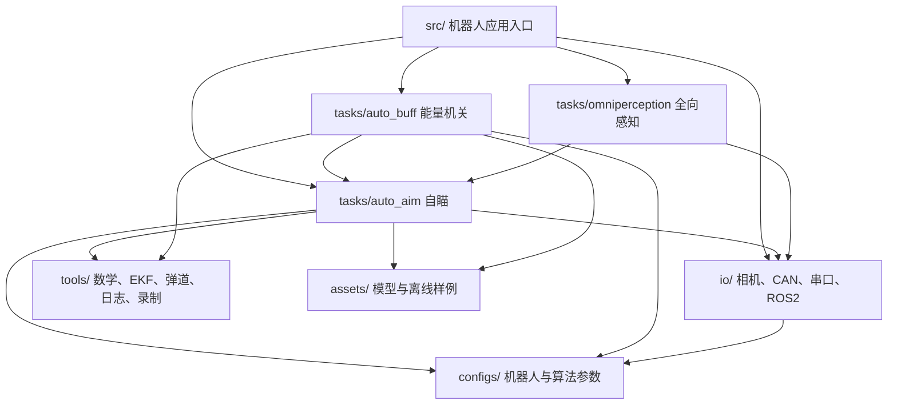
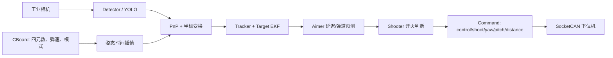
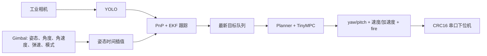
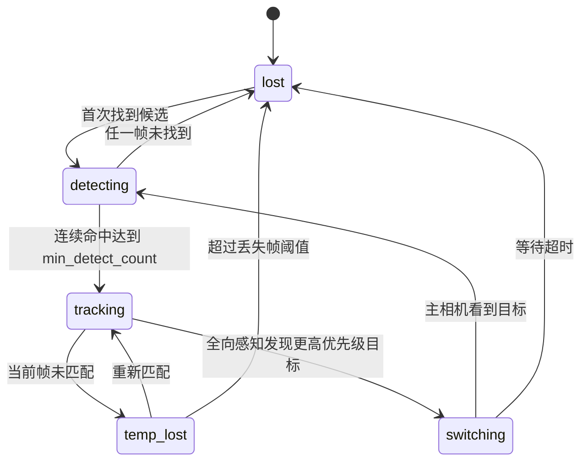
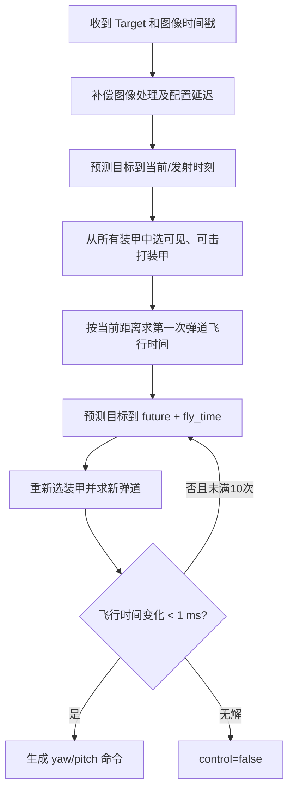

# sp_vision_25 项目介绍与实现说明

> 本文基于仓库当前代码静态阅读整理，阅读基准为提交 `bd9f5e7`。文中“已实现”表示可以在源码中找到完整调用链；“可选”表示受配置或编译环境控制；“待确认”表示仅凭仓库无法验证硬件侧行为或实车效果。

> 本地 UART 改造说明（2026-10-10）：本文原有“新链路/新串口”指 `Gimbal + SP/CRC + MPC`。本次增加的是 `CBoard/SocketCAN` 内按 `use_can: false` 选择的自定义 UART，标准为 new_uart1/new_uart2，接收 27 字节欧拉角、发送 13 字节浮点命令，无 CRC 或控制/开火标志。差异、流程、使用和实测限制见 [VERSION_COMPARISON_AND_USAGE.md](VERSION_COMPARISON_AND_USAGE.md) 与 [SERIAL_IMU_GUIDE.md](SERIAL_IMU_GUIDE.md)。

配套文档：

- [开发与使用指南](DEVELOPMENT_GUIDE.md)：构建、离线测试、三类相机入口、配置、测试程序与二次开发。
- [新版自瞄 Planner 开发指南](PLANNER_DEVELOPMENT_GUIDE.md)：聚焦 `standard_mpc` 的完整自瞄调用链、目标预测、弹道补偿、TinyMPC 轨迹规划、开火判定和调试方法。
- [相机配置与排障指南](CAMERA_GUIDE.md)：USB 白屏与参数回读、海康 MVS、迈德威视、曝光/增益/帧率和相机故障定位。
- [相机与手眼标定指南](CALIBRATION_GUIDE.md)：标定板规格、内参、手眼外参、数据采集、数学含义与结果验证。

## 目录

1. [项目概览](#1-项目概览)
2. [设计目标与主要特点](#2-设计目标与主要特点)
3. [技术栈与运行环境](#3-技术栈与运行环境)
4. [总体软件架构](#4-总体软件架构)
5. [目录结构](#5-目录结构)
6. [两代运行链路](#6-两代运行链路)
7. [数据、时间与坐标系](#7-数据时间与坐标系)
8. [自动瞄准实现](#8-自动瞄准实现)
9. [能量机关实现](#9-能量机关实现)
10. [全向感知与哨兵协同](#10-全向感知与哨兵协同)
11. [硬件抽象与通信协议](#11-硬件抽象与通信协议)
12. [应用入口说明](#12-应用入口说明)
13. [配置系统](#13-配置系统)
14. [构建与运行](#14-构建与运行)
15. [标定流程](#15-标定流程)
16. [录制、日志与调试](#16-录制日志与调试)
17. [测试体系](#17-测试体系)
18. [推荐的参数调试流程](#18-推荐的参数调试流程)
19. [当前实现中需要注意的事项](#19-当前实现中需要注意的事项)
20. [二次开发指南](#20-二次开发指南)
21. [一帧自瞄数据的完整生命周期](#21-一帧自瞄数据的完整生命周期)
22. [尚需结合实车资料补充的内容](#22-尚需结合实车资料补充的内容)
23. [阅读源码的建议顺序](#23-阅读源码的建议顺序)
24. [专业术语详解](#24-专业术语详解)

## 1. 项目概览

`sp_vision_25` 是同济大学 SuperPower 战队面向 RoboMaster 2025 赛季开发的机器人视觉系统。项目以 C++17 为主要语言，运行在机器人上位机，负责从工业相机获取图像、识别装甲板或能量机关、结合云台 IMU 姿态完成空间解算、估计目标运动状态、预测未来击打位置，并通过 CAN 或串口向下位机发送云台控制与开火指令。

项目并非单一“目标检测程序”，而是一套完整的视觉闭环：

```text
图像采集
  -> 图像时间戳与 IMU 姿态对齐
  -> 目标检测及关键点提取
  -> PnP 位姿解算与坐标变换
  -> 目标关联、整车建模和状态估计
  -> 延迟补偿与弹道预测
  -> 瞄准点/控制轨迹规划
  -> 开火判断
  -> CAN 或串口下发
```

仓库主要提供三类业务能力：

1. **自动瞄准 `auto_aim`**：检测敌方装甲板，估计整车运动和旋转状态，预测装甲板未来位置并控制云台射击。
2. **能量机关 `auto_buff`**：检测能量机关扇叶与中心，估计旋转方向和角速度规律，预测目标扇叶位置。
3. **哨兵全向感知 `omniperception`**：使用多路 USB 相机寻找主相机视野外的高优先级目标，并与导航模块通过 ROS2 交换信息。

项目还包含工业相机驱动、CAN/串口通信、相机与手眼标定、视频和姿态录制、离线回放、曲线输出、硬件测试程序等基础设施。

## 2. 设计目标与主要特点

### 2.1 核心设计目标

- 将相机、通信、算法和机器人入口分层，允许不同兵种复用同一套检测、解算和预测代码。
- 在不依赖 ROS2 的情况下运行步兵、无人机等核心视觉流程；ROS2 仅作为哨兵导航协同的可选能力。
- 通过带时间戳的视频和四元数录制，使实车问题能够离线复现。
- 同时保留传统角度指令链路和基于 TinyMPC 的轨迹规划链路，支持逐步迁移。
- 将装甲板观测提升为“整车状态”，以统一处理平移、普通旋转和小陀螺场景。

### 2.2 项目特色

- **多检测器兼容**：自瞄支持传统灯条检测、YOLOv5、YOLOv8 和 YOLO11。
- **四点装甲板模型**：神经网络直接输出装甲板关键点，必要时可用传统灯条方法二次修正角点。
- **时间同步**：工业相机帧与 IMU 四元数均带 `steady_clock` 时间戳，通过球面线性插值获得曝光时刻附近的姿态。
- **整车 EKF**：状态不仅包含单块装甲板位置，还包含整车中心速度、车体旋转角速度、装甲板半径和高度差。
- **两种决策方式**：旧链路直接计算瞄准角并由 `Shooter` 判断开火；新链路对未来射击轨迹做 MPC 平滑并输出位置、速度、加速度前馈。
- **设备自恢复**：海康和迈德威视相机驱动包含采集守护线程；原 `Gimbal` 串口链路包含 CRC16、错误计数和重连逻辑。本地 CBoard UART 有头尾检查、超时及重连，但其图片协议没有 CRC。

## 3. 技术栈与运行环境

| 类别 | 技术/依赖 | 用途 |
|---|---|---|
| 语言与构建 | C++17、CMake 3.16+ | 主工程与多目标构建 |
| 图像与几何 | OpenCV | 图像处理、PnP、投影、视频读写、命令行参数 |
| 推理 | OpenVINO 2024.6 | YOLO 和分类模型推理，支持 CPU/GPU 配置 |
| 数学 | Eigen3 | 矩阵、四元数、EKF 和坐标变换 |
| 优化 | TinyMPC、Ceres | 自瞄轨迹规划；Ceres 为能量机关模块依赖 |
| 配置 | yaml-cpp | 机器人参数、标定参数、模型路径 |
| 日志与格式化 | spdlog、fmt | 控制台和文件日志 |
| 数据输出 | nlohmann/json | 向 PlotJuggler 输出调试数据 |
| 硬件接口 | HikRobot SDK、MindVision SDK、libusb、SocketCAN、串口 | 相机、C 板和云台通信 |
| 可选中间件 | ROS2、`sp_msgs` | 哨兵与导航通信 |

原项目说明给出的基准环境为 Ubuntu 22.04、Intel NUC12WSKI7、海康 MV-CS016-10UC、RoboMaster C 型开发板和 BMI088。仓库同时提供 x86_64 与 aarch64 的海康/迈德威视动态库目录，但实际可运行性仍取决于设备 SDK、USB 权限、CAN/串口设备名和模型运行设备。

### 3.1 数学记号与单位约定

后文公式统一使用以下记号。源码中少数变量名较短，例如 `a`、`w`、`l`，阅读时应以此表中的物理含义为准。

| 记号 | 类型 | 含义 | 常用单位 |
|---|---|---|---|
| `p` | 3 维列向量 | 空间点的位置，通常写作 `[x,y,z]^T` | m |
| `p_c`、`p_g`、`p_w` | 3 维列向量 | 同一点在相机、云台、世界坐标系中的坐标 | m |
| `R_{a→b}` | 3×3 矩阵 | 将坐标系 a 中的向量旋转到坐标系 b | 无量纲 |
| `t_{a→b}` | 3 维列向量 | 坐标系 a 原点在坐标系 b 中的平移 | m |
| `q` | 四元数 | 表示三维旋转，通信中按 `w,x,y,z` 排列 | 无量纲 |
| `yaw` | 标量 | 水平偏航角，绕竖直轴转动 | rad；配置中部分字段为 degree |
| `pitch` | 标量 | 俯仰角，描述上下方向 | rad；配置中部分字段为 degree |
| `roll` | 标量 | 横滚角，描述绕前向轴旋转 | rad |
| `d` | 标量 | 水平距离；特别说明时也可表示三维距离 | m |
| `t`、`dt`、`Δt` | 标量 | 时间和相邻采样时间差 | s |
| `v` | 标量或向量 | 线速度；弹道章节中的 `v0` 是弹丸初速度 | m/s |
| `ω` 或 `w` | 标量 | 角速度 | rad/s |
| `α` 或 `u` | 标量 | 角加速度；MPC 中也是控制输入 | rad/s² |
| `x` | 列向量 | 状态估计器内部状态，不等同于空间坐标的 x 分量 | 由各分量决定 |
| `z` | 列向量 | 传感器或视觉观测量 | 由各分量决定 |
| `P` | 方阵 | 状态估计误差协方差 | 各状态单位乘积 |
| `Q` | 方阵 | EKF 语境下的过程噪声协方差，表示运动模型本身的不确定性 | 各状态单位乘积 |
| `R` | 方阵 | EKF 语境下的测量噪声协方差，表示视觉观测的不确定性 | 各观测单位乘积 |
| `F` | 方阵 | 离散状态转移矩阵 | 混合单位 |
| `H` | 矩阵 | 观测函数对状态的一阶导数，即雅可比矩阵 | 混合单位 |
| `K` | 矩阵 | 卡尔曼增益，决定预测与观测各占多大权重 | 混合单位 |
| `I` | 方阵 | 单位矩阵 | 无量纲 |
| `N` | 整数 | 装甲板数量或 MPC 预测步数，依上下文确定 | 个 |
| `k` | 整数下标 | 离散时间步编号 | 无 |

约定 `||v||_2` 表示向量 `v` 的欧氏长度，`A^T` 表示矩阵转置，`A^{-1}` 表示矩阵逆，`diag(...)` 表示用给定元素构造对角矩阵。角度进入三角函数前均应为弧度。源码常用 `57.3 ≈ 180/π` 在度和弧度之间转换。

需要特别注意，同一字母在不同算法中可能被复用：EKF 的 `Q/R` 是噪声协方差，MPC 的 `Q/R` 是代价函数权重；弹道公式中的 `A` 是为简化推导定义的中间量，MPC 中的 `A` 是状态转移矩阵，大能量机关中的 `A` 则是角速度振幅。它们只在各自小节内有效，不能混用。

### 3.2 三类容易混淆的“预测”

本项目中“预测”至少有三种含义：

1. **状态预测**：EKF 根据匀速或正弦运动模型，把目标状态从上一帧推进到当前帧。
2. **命中点预测**：根据处理延迟、通信延迟和子弹飞行时间，把目标继续推进到预计命中时刻。
3. **控制轨迹预测**：TinyMPC 在一段有限时间窗口内生成云台能够跟随的角度、角速度和角加速度序列。

三者的输入、时间尺度和目的不同。EKF 解决“目标现在在哪里、怎样运动”，命中点预测解决“子弹到达时目标在哪里”，MPC 解决“云台怎样在物理约束下尽量跟上这条射击轨迹”。

## 4. 总体软件架构

项目采用“应用入口 + 功能模块 + 硬件抽象 + 通用工具”的分层方式。



这种结构解决了同一台机器人不能由多个进程同时独占相机的问题：每种机器人只运行一个 `main`，由入口程序读取下位机模式，再在自瞄、打符或空闲逻辑之间切换。

## 5. 目录结构

```text
sp_vision_25/
├── assets/                    # OpenVINO/ONNX 模型、二进制权重、离线 demo
│   └── demo/                  # 成对的 demo.avi 与 demo.txt
├── calibration/               # 图像采集、内参标定、手眼标定、视频拆帧
├── configs/                   # 各机器人独立 YAML 配置
├── io/                        # 硬件与通信抽象
│   ├── dm_imu/                # 达妙 IMU 接口
│   ├── gimbal/                # 新版串口云台协议
│   ├── hikrobot/              # 海康工业相机驱动、头文件和动态库
│   ├── mindvision/            # 迈德威视相机驱动、头文件和动态库
│   ├── ros2/                  # 可选导航发布/订阅接口
│   ├── serial/                # 内置跨平台串口库
│   ├── usbcamera/             # 全向感知 USB 相机
│   ├── camera.*               # 工业相机统一工厂接口
│   ├── cboard.*               # 旧版 SocketCAN/C 板协议
│   └── command.hpp            # 旧版角度控制命令
├── src/                       # 不同兵种、通信代际和调试模式的程序入口
├── tasks/
│   ├── auto_aim/              # 装甲板检测、PnP、跟踪、预测、瞄准、规划
│   │   ├── multithread/       # 异步推理与高频指令生成
│   │   ├── planner/           # 轨迹规划器及内置 TinyMPC
│   │   └── yolos/             # YOLOv5/v8/11 适配实现
│   ├── auto_buff/             # 能量机关检测、解算、状态估计和瞄准
│   └── omniperception/        # 多相机全向感知与目标优先级决策
├── tests/                     # 离线算法、硬件、通信和规划器测试程序
├── tools/                     # 通用基础设施
├── CMakeLists.txt             # 顶层构建定义
├── autostart.sh               # 桌面自启动入口
├── buff_layout.xml            # PlotJuggler 布局
├── mpc_layout.xml             # PlotJuggler 布局
└── readme.md                  # 官方说明、效果和轨迹规划理论
```

### 5.1 `tools/` 的职责

| 文件 | 作用 |
|---|---|
| `extended_kalman_filter.*` | 通用 EKF 预测/更新、Joseph 形式协方差更新、NIS/NEES 调试统计 |
| `trajectory.*` | 无空气阻力抛体弹道，输出低弹道俯仰角和飞行时间 |
| `ransac_sine_fitter.*` | 大能量机关角速度正弦参数拟合 |
| `thread_safe_queue.hpp` | 相机帧、IMU、推理请求等生产者/消费者队列 |
| `recorder.*` | 异步记录 MJPG 视频和同步四元数文本 |
| `plotter.*` | 输出 JSON 调试数据，供 PlotJuggler 消费 |
| `logger.*` | spdlog 控制台与 `logs/*.log` 双路日志 |
| `math_tools.*` | 欧拉角、坐标系、角度约束、雅可比等数学函数 |
| `img_tools.*` | 绘点、文字等图像调试工具 |
| `crc.*` | 新串口协议 CRC16 |
| `exiter.*` | 统一退出条件处理 |
| `pid.*` | PID 工具，当前主自瞄链路不直接使用 |

## 6. 两代运行链路

仓库同时存在旧版 CAN 链路和新版串口轨迹链路。它们共享检测、PnP 和跟踪模块，但输出数据结构不同。

### 6.1 旧版角度指令链路

典型入口：`mt_standard`、`uav`、`sentry_multithread`。



输出只包含目标 yaw、pitch 以及是否控制/射击。实际云台闭环和速度控制由下位机负责。

### 6.2 新版轨迹规划链路

典型入口：`standard_mpc`、`auto_aim_debug_mpc`。



该链路将未来射击轨迹经过加速度约束后输出，并提供速度、加速度前馈。`standard_mpc` 中规划线程约每 10 ms 计算一次，自瞄目标队列容量为 1，倾向于保留最新估计而不是积压历史结果。

## 7. 数据、时间与坐标系

### 7.1 核心数据对象

- `Armor`：颜色、编号、大小装甲类型、四个像素角点、检测框、置信度，以及解算后的云台/世界坐标。
- `Target`：对一辆目标机器人的整车状态估计，可生成该车全部装甲板的未来位置。
- `io::Command`：旧链路角度命令，字段为 `control`、`shoot`、`yaw`、`pitch`、`horizon_distance`。
- `auto_aim::Plan`：新链路规划结果，包含目标角、规划角、角速度、角加速度和开火标志。
- `PowerRune`：能量机关中心、五个扇叶槽位和当前目标扇叶。
- `DetectionResult`：全向相机的一组装甲板、时间戳及相对 yaw/pitch 偏移。

### 7.2 时间基准与姿态对齐

相机和通信模块统一使用 `std::chrono::steady_clock`，避免系统时间调整影响帧间隔。

旧版 `CBoard` 将每个四元数和接收时间写入队列。`imu_at(t)` 找到目标时间前后的两个姿态，并使用 Eigen `slerp` 插值。多数旧入口使用 `imu_at(image_time - 1ms)`，这里的 1 ms 是代码中的固定补偿值。

新版 `Gimbal` 读取带 CRC16 的串口帧，将四元数与接收时间入队，`q(image_time)` 同样做相邻姿态插值。图像时间戳是在相机 SDK 返回帧后记录，因此端到端预测仍通过配置中的 `high_speed_delay_time`、`low_speed_delay_time` 或 `predict_time` 补偿。

这里的 **SLERP（Spherical Linear Interpolation，球面线性插值）** 是四元数之间的旋转插值。设图像时间 `t_c` 位于两次 IMU 采样 `t_a`、`t_b` 之间，插值比例为：

```math
\lambda = \frac{t_c-t_a}{t_b-t_a}
```

其中 `λ=0` 表示完全采用前一姿态，`λ=1` 表示完全采用后一姿态。姿态结果为：

```math
q_c = \operatorname{slerp}(q_a,q_b,\lambda)
```

`q_a`、`q_b` 分别是 `t_a`、`t_b` 时刻的单位四元数，`q_c` 是图像时刻估计姿态。不能直接逐元素线性插值欧拉角，因为 yaw 跨越 `-π/π` 时会跳变，而且欧拉角插值不能保证旋转速度均匀。SLERP 沿单位四元数球面的最短圆弧插值，更适合姿态时间对齐。

### 7.3 坐标变换

自瞄 `Solver` 的主要变换为：

```text
装甲板模型坐标 --solvePnP--> 相机坐标
相机坐标 --R_camera2gimbal, t_camera2gimbal--> 云台坐标
云台坐标 --R_gimbal2world--> 世界坐标
```

代码中的具体关系是：

```math
p_g = R_{c\to g} p_c + t_{c\to g}
```

```math
p_w = R_{g\to w} p_g
```

```math
R_{g\to w} = R_{g\to imu}^{T} R_{imuBody\to imuAbs} R_{g\to imu}
```

式中：

- `p_c` 是 PnP 输出的装甲板中心在相机坐标系中的位置；
- `p_g` 是该点在云台机械坐标系中的位置；
- `p_w` 是该点经过 IMU 姿态稳定后的世界坐标；
- `R_{c→g}` 和 `t_{c→g}` 是手眼标定得到的相机到云台外参；
- `R_{g→imu}` 描述云台坐标轴和 IMU 本体坐标轴之间的固定安装关系；
- `R_{imuBody→imuAbs}` 由下位机发送的四元数转换而来；
- 上标 `T` 表示转置。旋转矩阵是正交矩阵，因此 `R^{-1}=R^T`。

`tools::xyz2ypd` 将笛卡尔坐标 `[x,y,z]^T` 转成 `[yaw,pitch,distance]^T`：

```math
yaw = \operatorname{atan2}(y,x)
```

```math
pitch = \operatorname{atan2}\left(z,\sqrt{x^2+y^2}\right)
```

```math
distance = \sqrt{x^2+y^2+z^2}
```

`atan2(y,x)` 与普通 `atan(y/x)` 不同，它同时利用 x、y 的符号判断象限，并能在 x 接近 0 时保持正确方向。反变换为：

```math
x=d\cos(pitch)\cos(yaw),\quad
y=d\cos(pitch)\sin(yaw),\quad
z=d\sin(pitch)
```

其中 `d` 是三维斜距，不是弹道模块使用的水平距离。弹道水平距离需要另算为 `sqrt(x²+y²)`。

世界坐标原点等价于云台参考原点，代码没有再引入底盘在全局地图中的平移。因此当前自瞄估计的是目标相对云台的世界稳定坐标，而不是导航地图坐标。这也是官方说明中“暂未处理自身平移、无法稳定边跑边打”的根本原因之一。

## 8. 自动瞄准实现

### 8.1 装甲板检测

统一入口为 `auto_aim::YOLO`，通过 YAML 中的 `yolo_name` 在 `yolov5`、`yolov8`、`yolo11` 之间选择。

| 实现 | 输入 | 输出及后处理 | 适用说明 |
|---|---:|---|---|
| YOLOv5 | 640×640 | 四角点、颜色和编号分别输出；NMS 后构造 `Armor` | 可选传统灯条角点二次修正 |
| YOLOv8 | 416×416 | 框和四角点；再调用 32×32 数字分类器 | 颜色/类型还需结合后处理 |
| YOLO11 | 640×640 | 38 类和关键点；直接映射颜色、编号、大小装甲 | 配置文件普遍保留该模型路径 |
| `Detector` | 原图 | 二值化、轮廓、灯条配对、数字分类 | `uav` 当前直接使用；也用于角点修正 |

共同处理步骤如下：

1. 按比例缩放到网络输入尺寸，右侧或下侧用黑色填充，不拉伸原图。
2. OpenVINO 负责 BGR 到 RGB、数据类型转换和归一化。
3. 根据置信度阈值过滤候选框，并执行 NMS。
4. 构造四角点顺序一致的 `Armor`。
5. 过滤 `not_armor`、不合理的大小装甲类型或低置信度结果。
6. 可选启用 ROI；结果角点通过 ROI 偏移还原到原图坐标。

传统检测器根据灯条角度、长宽比、长度、两侧比例、矩形误差等几何阈值筛选候选装甲，并用 `tiny_resnet.onnx` 对装甲图案分类。相关阈值集中在 YAML 的“传统方法参数”组。

这里几个检测术语的含义是：

- **ROI（Region of Interest，感兴趣区域）**：只裁取原图的一部分送入网络，可减少无关背景和推理量；代价是 ROI 外的目标完全不可见。
- **关键点（keypoint）**：网络回归的装甲板四个物理角点。它们比普通矩形框包含更多姿态信息，是后续 PnP 的直接输入。
- **置信度（confidence）**：模型认为候选属于目标类别的相对可信程度。它不是严格概率，也不能跨模型直接比较。
- **NMS（Non-Maximum Suppression，非极大值抑制）**：多个候选框覆盖同一目标时，保留高置信度框并删除与它高度重叠的低分框。
- **IoU（Intersection over Union，交并比）**：两个框交集面积除以并集面积。NMS 使用 IoU 判断两个候选是否很可能是同一目标。

若两个框分别为 `B1`、`B2`，则：

```math
IoU(B_1,B_2)=\frac{area(B_1\cap B_2)}{area(B_1\cup B_2)}
```

IoU 越接近 1，两个框越重合。NMS 阈值过低可能误删相邻装甲，过高则可能保留同一装甲的重复框。

### 8.2 PnP 与装甲 yaw 优化

`Solver::solve` 使用 OpenCV `SOLVEPNP_IPPE`。物理模型尺寸为：

- 灯条高度：56 mm；
- 小装甲宽度：135 mm；
- 大装甲宽度：230 mm。

解算得到装甲板在相机坐标系中的平移和旋转，再变换到云台坐标和世界坐标。由于单目 PnP 对装甲板 yaw 较敏感，代码会在云台朝向附近 140° 范围内按 1° 步长搜索，通过重投影误差选择最佳世界 yaw。平衡步兵的大装甲板不执行该优化，因为其 pitch 假设不成立。

**PnP（Perspective-n-Point）** 的问题定义是：已知同一物体上若干三维点 `P_i`、它们在图像中的二维像素 `u_i`，以及相机内参，求物体相对于相机的旋转 `R` 与平移 `t`。理想针孔相机模型写作：

```math
s
\begin{bmatrix}u\\v\\1\end{bmatrix}
=
K
\begin{bmatrix}R&t\end{bmatrix}
\begin{bmatrix}X\\Y\\Z\\1\end{bmatrix}
```

变量含义：

- `[X,Y,Z]^T` 是装甲模型上的三维点，单位为米；
- `[u,v]^T` 是该点在图像上的像素坐标，单位为 pixel；
- `R` 是物体坐标到相机坐标的旋转矩阵；
- `t` 是物体原点在相机坐标中的平移，也就是距离解算的核心结果；
- `s` 是透视投影产生的比例因子，与点的相机深度有关；
- `K` 是相机内参矩阵：

```math
K=
\begin{bmatrix}
f_x&0&c_x\\
0&f_y&c_y\\
0&0&1
\end{bmatrix}
```

`f_x`、`f_y` 是以像素为单位的水平/竖直焦距，`c_x`、`c_y` 是主点，通常接近图像中心。YAML 中的 `distort_coeffs=[k1,k2,p1,p2,k3]` 分别描述径向畸变和切向畸变：径向畸变表现为桶形或枕形弯曲，切向畸变主要来自镜头与传感器平面不完全平行。

项目使用的 **IPPE（Infinitesimal Plane-Based Pose Estimation）** 是针对共面点优化的 PnP 方法。装甲板四点位于同一平面，IPPE 比通用迭代 PnP 更符合问题结构，但平面目标仍可能出现姿态二义性：不同姿态在图像上投影很接近，尤其正对相机或目标较远时，yaw 会对几个像素的角点误差非常敏感。

为降低这种敏感性，代码枚举候选 yaw `ψ`，把物理装甲重新投影到图像，计算：

```math
E(\psi)=\sum_{i=1}^{4}\left\|u_i-\hat{u}_i(\psi)\right\|_2
```

`u_i` 是检测到的第 i 个角点，`û_i(ψ)` 是候选 yaw 下的重投影角点，`E(ψ)` 是四点像素误差总和。选择 `E` 最小的 yaw。**重投影误差**因此既可衡量标定质量，也可衡量某个三维姿态对当前二维观测的解释程度。

### 8.3 Tracker 状态机

`Tracker` 只维护一个当前主目标，状态转换如下：



除状态机外，以下情况会强制回到 `lost`：

- 相邻图像时间差超过 0.1 s；
- EKF 估计的装甲半径越出 0.05 到 0.5 m；
- 最近窗口内 NIS 失败次数达到窗口的 40%。

普通目标和前哨站使用不同的临时丢失阈值。主相机候选先按画面中心距离和优先级排序，再按编号、装甲类型与当前目标关联。

### 8.4 整车 EKF 模型

`Target` 的 11 维状态为：

```text
x = [cx, vx, cy, vy, cz, vz, a, w, r, l, h]^T
```

| 状态 | 含义 |
|---|---|
| `cx, cy, cz` | 目标旋转中心在世界坐标中的位置 |
| `vx, vy, vz` | 目标中心线速度 |
| `a` | 第 0 块装甲板绕车体中心的相位角 |
| `w` | 车体旋转角速度 |
| `r` | 第一组装甲板半径 |
| `l` | 另一组半径相对 `r` 的差，即 `r2 = r + l` |
| `h` | 两组装甲板高度差 |

这里的状态量 `a` 是 angle（相位角）的缩写，不是 acceleration（加速度）；后文大能量机关源码中的局部变量 `a` 又表示正弦振幅。为了避免歧义，公式分别写作相位 `a` 和振幅 `A`。

#### 8.4.1 什么是 EKF

**EKF（Extended Kalman Filter，扩展卡尔曼滤波）** 是用于非线性系统的递推状态估计器。它不会只相信模型或只相信当前检测，而是维护两个量：

- 状态估计 `x`：当前认为目标最可能处于什么状态；
- 协方差 `P`：对这个状态有多不确定。对角元素越大，表示对应状态分量越不可信；非对角元素表示不同状态误差之间的相关性。

“扩展”指的是：状态转移函数 `f(x)` 或观测函数 `h(x)` 可以是非线性的，但在当前估计点附近用一阶导数，也就是雅可比矩阵近似成线性问题。**雅可比矩阵（Jacobian）** 是多元函数所有一阶偏导数组成的矩阵，它描述状态发生微小变化时，观测会怎样变化。

#### 8.4.2 预测步骤

本项目自瞄状态的离散运动关系可以写成：

```math
\begin{aligned}
c_{x,k+1} &= c_{x,k}+v_{x,k}\Delta t \\
c_{y,k+1} &= c_{y,k}+v_{y,k}\Delta t \\
c_{z,k+1} &= c_{z,k}+v_{z,k}\Delta t \\
a_{k+1} &= \operatorname{wrap}(a_k+w_k\Delta t)
\end{aligned}
```

其中：

- 下标 `k` 表示当前离散帧，`k+1` 表示下一帧；
- `Δt` 是两帧时间差，单位为秒；
- `c_x,c_y,c_z` 是整车旋转中心坐标，单位为米；
- `v_x,v_y,v_z` 是对应线速度，单位为米每秒；
- `a` 是装甲相位角，单位为弧度；
- `w` 是车体角速度，单位为弧度每秒；
- `wrap` 对应 `limit_rad`，把角度限制到 `(-π,π]`，避免同一方向出现相差 `2π` 的数值表示。

速度、角速度、半径和高度差在一步预测内保持不变。这是**匀速模型（constant velocity model）**：并不是认为真实目标永远不加速，而是把未知加速度放进过程噪声 `Q`。

标准预测公式为：

```math
x_k^- = f(x_{k-1}^+)
```

```math
P_k^- = F_k P_{k-1}^+ F_k^T + Q_k
```

`x^-`、`P^-` 称为先验状态和先验协方差，即看到当前观测之前的预测；`x^+`、`P^+` 是融合观测后的后验结果；`F=∂f/∂x` 是状态转移雅可比。当前模型除角度归一化外是线性的，因此源码直接构造 11×11 的 `F`。

位置-速度或角度-角速度二元组的过程噪声块为：

```math
Q_{pair}=\sigma^2
\begin{bmatrix}
\Delta t^4/4 & \Delta t^3/2\\
\Delta t^3/2 & \Delta t^2
\end{bmatrix}
```

`σ²` 表示未建模加速度的方差。值越大，滤波器越愿意相信目标可能突然改变速度，响应更快但输出更抖；值越小，输出更平滑但转向或急停时滞后更明显。普通目标代码使用较大的线加速度和角加速度方差，前哨站因运动规律稳定而使用更小值。

#### 8.4.3 整车到装甲板的几何观测模型

设目标共有 `n` 块等角度分布的装甲板，第 i 块装甲的相位为：

```math
\psi_i=\operatorname{wrap}\left(a+i\frac{2\pi}{n}\right)
```

其中 `i=0,1,...,n-1`。装甲板中心位置为：

```math
\begin{aligned}
x_i &= c_x-\rho_i\cos\psi_i\\
y_i &= c_y-\rho_i\sin\psi_i\\
z_i &= c_z+\eta_i
\end{aligned}
```

`ρ_i` 是该装甲到车体旋转中心的半径。四装甲模型中，偶数编号使用 `r`，奇数编号使用 `r+l`；`η_i` 对偶数编号为 0，对奇数编号为 `h`。二装甲和三装甲模型不使用交替半径/高度。

这个公式解释了为什么滤波器估计的是整车中心而不是单块装甲：只要估计出 `c_x,c_y,c_z,a,w,r,l,h`，就能生成所有装甲板当前和未来的位置，即使其中某块暂时转到车后看不见。

状态转移假设中心匀速、相位按恒定角速度变化，半径和高度差保持不变。过程噪声使用分段白噪声模型，普通机器人和平稳旋转的前哨站采用不同的线加速度/角加速度方差。

观测不是直接使用笛卡尔坐标，而是：

```text
z = [armor_yaw_to_origin, armor_pitch_to_origin, distance, armor_world_yaw]
```

更新时先预测每个可能装甲板的位置和朝向，在距离最近的三个候选中选择角度误差最小者作为装甲 ID，再用非线性观测函数和雅可比更新 EKF。角度残差通过 `limit_rad` 归一化，避免跨越 ±π 时跳变。

观测函数可写成：

```math
h_i(x)=
\begin{bmatrix}
\operatorname{atan2}(y_i,x_i)\\
\operatorname{atan2}(z_i,\sqrt{x_i^2+y_i^2})\\
\sqrt{x_i^2+y_i^2+z_i^2}\\
\psi_i
\end{bmatrix}
```

第一项是装甲相对世界原点的 yaw，第二项是 pitch，第三项是三维距离，第四项是装甲板自身朝向。实际观测 `z` 来自 PnP 解算。`H=∂h/∂x` 通过“整车状态到装甲 xyz”和“xyz 到 yaw/pitch/distance”两段雅可比相乘得到，这就是链式法则在代码中的实现。

EKF 更新公式为：

```math
y_k=z_k-h(x_k^-)
```

```math
S_k=H_kP_k^-H_k^T+R_k
```

```math
K_k=P_k^-H_k^TS_k^{-1}
```

```math
x_k^+=x_k^-+K_ky_k
```

```math
P_k^+=(I-K_kH_k)P_k^-(I-K_kH_k)^T+K_kR_kK_k^T
```

变量解释：

- `y_k` 是**创新（innovation）或残差（residual）**，表示实际观测与模型预测观测之差；
- `S_k` 是创新协方差，表示这次残差理论上有多大波动；
- `K_k` 是卡尔曼增益。`R` 较小时更相信观测，`P^-` 较大时也更需要观测纠正；
- 最后一式是 **Joseph form（Joseph 稳定形式）**，比简写的 `(I-KH)P` 更能在浮点误差下保持 `P` 对称和半正定。

由于 yaw、pitch 和装甲朝向都是周期角，普通减法会把 `179°` 到 `-179°` 误判为 `-358°`。项目在残差函数中对这些角度执行 `wrap`，得到正确的约 `2°` 差值。

#### 8.4.4 NIS、NEES 与收敛检查

**NIS（Normalized Innovation Squared，归一化创新平方）** 用来判断“观测残差相对于预期噪声是否过大”，标准形式为：

```math
NIS=y_k^TS_k^{-1}y_k
```

若模型、`Q`、`R` 设置合理，NIS 应大致服从自由度等于观测维数的卡方分布。NIS 连续过大通常意味着匹配错目标、模型跟不上机动、测量噪声低估或坐标/时间没有对齐。

**NEES（Normalized Estimation Error Squared，归一化估计误差平方）** 的标准定义需要真实状态 `x_true`：

```math
NEES=(x-x_{true})^TP^{-1}(x-x_{true})
```

实车没有真实整车状态时，严格 NEES 无法直接计算。当前代码以一次更新前后的状态差代替真实估计误差，因此这里只能把 `nees` 当作“单次修正幅度经协方差归一化后的调试指标”，不能当作标准 NEES 一致性检验。

还需注意，当前实现是在状态和协方差更新之后重新计算 residual 与 `S`，并在 `NIS > 0.711` 或 `NEES > 0.711` 时记为失败。对 4 自由度卡方分布而言，`0.711` 是约 5% 的下分位点，常用的 95% 上分位点约为 `9.488`；因此源码注释所称的“95% 阈值”和实际数值、比较方向并不一致。文档中的“最近 NIS 失败率”只能理解为当前代码自定义的健康指标，不能直接按统计教材解释。若要将它用于严格卡方一致性检验，需要统一先验/后验计算时机、自由度、显著性水平以及上下界的判断方式。

不同目标采用不同几何模型：

| 目标 | 装甲数量 | 初始半径 | 特殊处理 |
|---|---:|---:|---|
| 平衡步兵大装甲 | 2 | 0.20 m | 两面模型 |
| 前哨站 | 3 | 0.2765 m | 收敛更慢；收敛后角速度钳位到约 ±2.51 rad/s |
| 基地 | 3 | 0.3205 m | 三面模型 |
| 普通机器人 | 4 | 0.20 m | 支持两组半径和高度差 |

### 8.5 传统 Aimer 预测流程

`Aimer::aim` 的处理顺序是：



具体规则：

- 弹速异常时使用默认值；旧 `Aimer` 在弹速小于 14 m/s 时改为 23 m/s。
- 延迟参数按目标角速度在 `high_speed_delay_time` 和 `low_speed_delay_time` 间选择。
- 目标未发生过装甲跳变时，只能可靠使用当前装甲板。
- 普通低速场景选择朝向更正、处于可射击角范围内的装甲；两个候选接近时使用锁定 ID，防止来回切换。
- 小陀螺或前哨站场景根据旋转方向、进入角和离开角选择即将转入正面的装甲板。
- 弹道与目标预测最多迭代 10 次，相邻飞行时间差小于 1 ms 时认为收敛。
- 最终 yaw 由目标水平坐标计算，pitch 来自抛物线弹道并叠加标定偏置。

总预测时间可概念化为：

```math
t_{predict}=t_{now}-t_{image}+t_{fixed}+t_{fly}
```

其中：

- `t_image` 是当前图像时间戳；
- `t_now-t_image` 是图像采集、推理、PnP 和跟踪已经消耗的时间；
- `t_fixed` 是配置中的额外延迟，用来近似通信、下位机响应等无法直接测量的延迟；
- `t_fly` 是子弹飞行时间。

`t_fly` 又依赖未来目标距离，而未来距离依赖 `t_fly`，所以这是一个隐式问题。代码采用**不动点迭代（fixed-point iteration）**：先用当前距离求 `t_fly^(0)`，再预测到该时刻、重新求 `t_fly^(1)`，直到：

```math
\left|t_{fly}^{(j+1)}-t_{fly}^{(j)}\right|<0.001\;s
```

或达到 10 次上限。这里 `j` 是迭代编号。收敛表示“用于预测的飞行时间”和“预测位置重新计算出的飞行时间”已经自洽。

### 8.6 弹道模型

`tools::Trajectory` 使用重力加速度 `g = 9.7833 m/s²`，忽略空气阻力。设弹丸出膛速度为 `v0`，发射仰角为 `θ`，目标水平距离为 `d`，目标相对枪口高度为 `h`。理想抛体方程为：

```math
d=v_0\cos\theta\;t
```

```math
h=v_0\sin\theta\;t-\frac{1}{2}gt^2
```

第一式描述水平方向匀速运动，第二式描述竖直方向受重力匀加速运动。消去飞行时间 `t`，并令 `u=tanθ`、`A=gd²/(2v0²)`，得到：

```math
A u^2-d u+(A+h)=0
```

源码中的局部变量对应为：

```text
a = A = g*d*d/(2*v0*v0)
b = -d
c = A + h
delta = b*b - 4*a*c
```

因此：

```math
u_{1,2}=\frac{d\pm\sqrt{d^2-4A(A+h)}}{2A}
```

```math
\theta_{1,2}=\arctan(u_{1,2}),\qquad
t_{1,2}=\frac{d}{v_0\cos\theta_{1,2}}
```

两个根通常对应高弹道和低弹道。代码选择飞行时间更短的解，并输出：

- `pitch=θ`：枪口理论仰角，单位 rad；
- `fly_time=t`：弹丸到达目标所需时间，单位 s；
- `unsolvable`：当前速度与目标位置是否存在实数弹道解。

若判别式小于 0，则标记 `unsolvable`，上层停止控制或规划。该模型简洁且运行开销低，但远距离、弹丸阻力明显或测速误差较大时需要额外标定或替换为更完整的弹道模型。

“忽略空气阻力”意味着模型假设弹丸水平方向不减速、竖直方向只受恒定重力。真实弹丸会受到随速度变化的阻力，因此 `yaw_offset`、`pitch_offset` 只能补偿固定系统偏差，无法完全替代不同距离和速度下的阻力模型。

### 8.7 旧版开火判断

`Shooter` 根据以下条件决定 `shoot`：

- 当前命令有效、目标存在且 `auto_fire=true`；
- 新旧指令 yaw 变化不能过大，防止装甲切换瞬间射击；
- 当前云台 yaw 与上一帧指令 yaw 的误差小于容差；
- `Aimer` 选择出的瞄准点仍有效。

近距离和远距离分别使用 `first_tolerance`、`second_tolerance`，切换距离由 `judge_distance` 决定。

若把距离对应的角度容差记为 `ε`，上一帧有效指令记为 `ψ_cmd,prev`，当前新指令记为 `ψ_cmd`，当前云台角记为 `ψ_gimbal`，代码的主要判断可写成：

```math
|\psi_{cmd,prev}-\psi_{cmd}|<2\epsilon
```

```math
|\psi_{gimbal}-\psi_{cmd,prev}|<\epsilon
```

第一式抑制目标切换造成的指令突变，第二式要求云台已经接近上一帧要求的位置。这里比较的是 yaw，未直接将 pitch 误差纳入旧版 `Shooter` 判断。

### 8.8 TinyMPC 轨迹规划

`Planner` 将目标轨迹转换为云台可执行轨迹。其关键常量为：

```text
DT = 0.01 s
HORIZON = 100
HALF_HORIZON = 50
```

因此规划窗口约为 1 秒，并围绕当前求解时刻构造前后轨迹。流程如下：

1. 选择当前水平距离最近的装甲板。
2. 由弹道模型计算飞行时间，将目标先预测到子弹到达时刻。
3. 在 100 个采样点上计算未来 yaw/pitch 及其中心差分速度，形成射击参考轨迹。
4. yaw 和 pitch 分别按双积分模型求解：状态为角度和角速度，控制量为角加速度。
5. 使用 `max_yaw_acc`、`max_pitch_acc` 约束控制量，用 `Q_*` 权衡轨迹误差，用 `R_*` 惩罚控制量。
6. 输出窗口中点的角度、角速度和角加速度给下位机。

开火判断比较参考射击轨迹和 MPC 规划轨迹在中点后 2 个采样点，即约 20 ms 后的 yaw/pitch 二维误差；小于 `fire_thresh` 才置 `fire=true`。这对应“提前判断子弹出膛时刻是否仍在射击窗口”的设计思想。

#### 8.8.1 MPC 中的状态与约束

**MPC（Model Predictive Control，模型预测控制）** 通常指：利用系统模型预测未来若干步，在约束下优化控制序列，只执行第一步，然后滚动重算。本项目借用同一类有限时域优化器，但上位机 `Planner` 的主要作用是“参考轨迹整形”，不读取真实云台状态做闭环反馈；真正的云台反馈控制仍在下位机。

yaw 和 pitch 各自使用同一个离散双积分模型：

```math
x_k=
\begin{bmatrix}\theta_k\\\dot\theta_k\end{bmatrix},\qquad
u_k=\ddot\theta_k
```

```math
x_{k+1}=
\underbrace{\begin{bmatrix}1&\Delta t\\0&1\end{bmatrix}}_{A}x_k+
\underbrace{\begin{bmatrix}0\\\Delta t\end{bmatrix}}_{B}u_k
```

其中 `θ` 是 yaw 或 pitch 角度，`θ̇` 是角速度，`θ̈` 是角加速度，`Δt=0.01 s`。源码的 `B` 第一项为 0，因此一个采样步内加速度先改变速度，角度通过后续步的速度累积变化；它没有使用连续匀加速离散化中常见的 `0.5Δt²` 项。

控制约束为：

```math
-u_{max}\le u_k\le u_{max}
```

yaw 的 `u_max=max_yaw_acc`，pitch 的 `u_max=max_pitch_acc`。这些值代表希望规划器遵守的最大角加速度，而不是算法自动识别出的硬件极限，必须通过云台能力测试得到。

#### 8.8.2 目标函数

规划器求解的代价可概念化为：

```math
J=\sum_{k=0}^{N-1}
(x_k-x_{ref,k})^TQ(x_k-x_{ref,k})
+
\sum_{k=0}^{N-2}u_k^TRu_k
+
(x_{N-1}-x_{ref,N-1})^TP_f(x_{N-1}-x_{ref,N-1})
```

变量含义：

- `N=100` 是预测步数，时间跨度约 1 s；
- `x_ref,k` 是第 k 步目标射击角和目标角速度；
- `x_k` 是规划后的角度和角速度；
- `u_k` 是规划角加速度；
- `Q=diag(Q_angle,Q_velocity)` 惩罚跟踪误差；数值越大越强调贴近射击轨迹；
- `R` 惩罚角加速度；数值越大越倾向平滑、保守的动作；
- `P_f` 是终端代价矩阵，用于约束窗口末端状态。

这是**二次规划（Quadratic Programming, QP）**：目标函数对优化变量是二次的，动力学和上下界约束是线性的。TinyMPC 使用 Riccati 递推和 **ADMM（Alternating Direction Method of Multipliers，交替方向乘子法）** 高效求解。ADMM 将带约束问题拆成较容易的子问题，交替更新原变量、辅助变量和对偶变量，直到原始残差和对偶残差足够小。当前 `Planner` 将最大迭代次数限制为 10，以换取实时性。

#### 8.8.3 开火误差

设检查点 `j=HALF_HORIZON+2=52`，参考与规划角分别为 `yaw_ref,j`、`pitch_ref,j` 和 `yaw_plan,j`、`pitch_plan,j`，代码计算：

```math
e_{fire}=\sqrt{
(yaw_{ref,j}-yaw_{plan,j})^2+
(pitch_{ref,j}-pitch_{plan,j})^2}
```

当 `e_fire < fire_thresh` 时允许开火。`e_fire` 是 yaw/pitch 平面中的角距离，单位为 rad，不是目标平面上的米制距离。相同角误差在远距离会对应更大的横向偏差，因此固定 `fire_thresh` 是否适合全部距离仍需通过命中数据验证。

## 9. 能量机关实现

能量机关链路为：

```text
YOLO11 扇叶关键点
  -> 估计 R 中心并组织五扇叶 PowerRune
  -> PnP 解算机关平面姿态
  -> 小符/大符 Target 状态估计
  -> 预测转角与目标点
  -> 弹道修正
  -> 定频开火
```

### 9.1 检测与目标扇叶选择

`YOLO11_BUFF` 使用 640×640 输入和 5 个关键点描述扇叶。`Buff_Detector` 支持单候选和多候选路径：

- 根据关键点向机关中心方向外推，获得 R 中心粗估计；
- 在灰度二值化、膨胀后的局部区域中用轮廓进一步寻找中心；
- 根据上一帧亮起扇叶数量和位置，判断当前目标扇叶；
- 将检测结果按相对角度映射到五个相隔 `2π/5` 的槽位，缺失位置用未亮扇叶占位；
- 连续丢失达到阈值后清空历史目标。

### 9.2 位姿解算

`auto_buff::Solver` 使用扇叶关键点、目标点和 R 中心组成的物理模型进行 PnP。模型中目标点距机关中心约 0.7 m，并通过五组绕机关轴旋转的点集描述五个扇叶位置。解算结果同样经过相机到云台、云台到世界坐标变换。

### 9.3 小能量机关预测

`SmallTarget` 使用 7 维状态：

```text
[R_yaw, R_yaw_velocity, R_pitch, R_distance, plane_yaw, blade_angle, angular_speed]
```

代码将小符角速度设为 `π/3 rad/s`，旋转方向由相邻角度投票确定。EKF 同时使用 R 中心球坐标、机关平面姿态和目标扇叶球坐标更新状态。

各分量含义为：

| 分量 | 含义 | 单位 |
|---|---|---|
| `R_yaw` | 世界原点指向机关 R 中心的水平角 | rad |
| `R_yaw_velocity` | R 中心水平角变化速度，主要吸收相机与机关的相对运动 | rad/s |
| `R_pitch` | 世界原点指向 R 中心的俯仰角 | rad |
| `R_distance` | 世界原点到 R 中心的三维距离 | m |
| `plane_yaw` | 能量机关平面相对世界坐标的 yaw 姿态 | rad |
| `blade_angle` | 目标扇叶绕 R 中心的相位角，源码注释也称 row/roll | rad |
| `angular_speed` | 扇叶相位角速度，大小固定为 `π/3`，符号由旋转方向决定 | rad/s |

“方向投票”是对连续帧角度增减趋势进行累计判断。单帧关键点抖动可能让角度瞬时反向，投票比只看一帧符号更稳健。扇叶切换时相位会跳过约 `2π/5`，代码会尝试加减若干个 `2π/5`，把新观测展开到最接近当前连续相位的位置。

### 9.4 大能量机关预测

`BigTarget` 使用 10 维状态：

```text
[R_yaw, R_yaw_velocity, R_pitch, R_distance,
 plane_yaw, blade_angle, angular_speed, amplitude, frequency, phase]
```

前六项与小符相同；后四项描述大符的变速规律：

| 分量 | 数学记号 | 含义 | 单位 |
|---|---|---|---|
| `angular_speed` | `v_θ` | 当前扇叶角速度 | rad/s |
| `amplitude` | `A` | 角速度正弦变化的振幅 | rad/s |
| `frequency` | `Ω` | 正弦变化的角频率，不是普通频率 Hz | rad/s |
| `phase` | `φ` | 正弦函数初相位 | rad |

`BigTarget::predict` 中采用的规则模型为：

```math
v_\theta(t)=A\sin(\Omega t+\phi)+2.09-A
```

其中 `t` 是模块传入的连续时间标量，单位 s；它与 `lasttime_` 使用同一时钟基准，并不要求从目标初始化时刻归零，因为时间原点的变化可以并入相位 `φ`。常数 `2.09` 的单位是 rad/s，`2.09-A` 是直流偏置，因此角速度围绕非零均值变化。代码期望 `A` 大致位于 0.78 到 1.045 rad/s，`Ω` 大致位于 1.884 到 2.000 rad/s。由速度积分得到相位增量：

```math
\Delta\theta=
-\frac{A}{\Omega}\cos(\Omega t_1+\phi)
+\frac{A}{\Omega}\cos(\Omega t_0+\phi)
+(2.09-A)(t_1-t_0)
```

`t0`、`t1` 是同一时钟基准下的预测区间起止时间，单位 s；`Δθ` 是这段时间内的扇叶转角，单位 rad。最后再乘旋转方向 `s∈{-1,+1}`：`+1` 和 `-1` 分别代表方向投票器判定的两种旋向，并对角度执行 `wrap`。

模块还运行 `RansacSineFitter`，拟合更一般的模型：

```math
v(t)=A\sin(\Omega t+\phi)+C
```

**RANSAC（Random Sample Consensus，随机采样一致性）** 是一种抗离群点拟合方法。一次迭代随机取少量样本生成候选模型，再统计全部数据中有多少点与该模型足够接近；接近的点称为**内点（inlier）**，偏差过大的点称为离群点。最终选择内点最多的模型，而不是让少数错误检测把普通最小二乘结果拉偏。

本实现每次随机选择 3 个样本，并在 `[1.884,2.000]` 中随机选择 `Ω`。固定 `Ω` 后，将正弦展开为线性形式：

```math
v(t)=A_1\sin(\Omega t)+A_2\cos(\Omega t)+C
```

然后用 SVD 最小二乘求 `A1,A2,C`，再恢复：

```math
A=\sqrt{A_1^2+A_2^2},\qquad
\phi=\operatorname{atan2}(A_2,A_1)
```

这里 `A1=A cosφ`、`A2=A sinφ`，两者单位均为 rad/s；`C` 是角速度的直流分量，单位也是 rad/s。把未知振幅和相位改写为 `A1/A2` 后，在固定 `Ω` 时模型对三个待估参数是线性的，因而可以直接使用线性最小二乘求解。

SVD（Singular Value Decomposition，奇异值分解）是一种稳定求解最小二乘问题的矩阵分解方法，对接近奇异或样本尺度不理想的矩阵通常比直接求逆稳健。代码最多随机尝试 100 次，以绝对速度残差小于 0.5 作为内点，并只保留约 150 个最近样本。

需要区分设计和当前实现：RANSAC 结果被保存到 `fit_spd_` 并用于调试字段，但 `BigTarget::predict` 内声明的 `spd=fit_spd_` 没有参与后续状态推进；实际预测仍使用 EKF 状态中的 `A、Ω、φ` 和上述规则公式。因此当前代码不能简单描述为“由 RANSAC 拟合结果驱动预测”。

### 9.5 打符瞄准与开火

打符 `Aimer` 先补偿图像处理延迟与 `predict_time`，再预测一次扇叶位置；根据第一次弹道飞行时间再次预测并重算弹道。当两次飞行时间相差超过 10 ms 时拒绝输出。

为避免扇叶切换时的大角度跃变，若相邻目标角变化超过 5°，代码会暂时停止控制和射击，并最多容忍若干次异常。稳定后按 `fire_gap_time` 控制开火间隔。

`mpc_aim` 名称虽然包含 MPC，但其能量机关实现并未调用 TinyMPC；它根据相邻预测点和云台当前状态计算角速度、角加速度前馈，然后通过新版串口协议发送。

## 10. 全向感知与哨兵协同

`omniperception::Perceptron` 为四个 USB 相机分别创建线程和独立 YOLO 实例。每个线程输出装甲板列表及相对云台的 yaw/pitch 偏移，写入容量为 10 的共享队列。

`Decider` 负责：

- 过滤非敌方颜色、前哨站、5 号装甲和处于无敌状态的机器人；
- 按配置的两套优先级表为目标排序；
- 根据 `left`、`right`、`back` 相机的安装方向和视场角，将像素中心转换为相对角度；
- 主相机丢失目标时，引导云台转向全向相机发现的目标；
- 发现比当前跟踪对象优先级更高的目标时，触发 Tracker 的 `switching` 状态。

哨兵入口通过可选 ROS2 模块：

- 发布当前目标在云台坐标中的信息；
- 订阅敌方无敌状态；
- 订阅导航指定的自瞄目标编号。

只有 CMake 同时找到 `ament_cmake`、`rclcpp`、`std_msgs`、`rosidl_typesupport_cpp` 和外部消息包 `sp_msgs` 时，才会编译哨兵与 ROS 测试目标。

## 11. 硬件抽象与通信协议

### 11.1 工业相机

`io::Camera` 是运行时工厂：

- `camera_name: hikrobot` 创建 `HikRobot`；
- `camera_name: mindvision` 创建 `MindVision`。

两种驱动都将相机采集放在线程中，通过容量较小的队列向算法线程提供最新帧。海康驱动在采集失败后停止采集、尝试 USB reset 并重开设备；迈德威视也具有独立采集和守护线程。

### 11.2 旧版 CBoard / SocketCAN

接收数据按 CAN ID 区分：

- `quaternion_canid`：四个 `int16`，按 `x,y,z,w` 传输并除以 `1e4`；
- `bullet_speed_canid`：弹速、工作模式、哨兵左右枪模式、无人机专用角度。

发送帧固定 8 字节：

| 字节 | 内容 |
|---:|---|
| 0 | 是否接管控制 |
| 1 | 是否开火 |
| 2-3 | yaw，弧度乘 `1e4` 后按 `int16` 发送 |
| 4-5 | pitch，同上 |
| 6-7 | 水平距离，同上 |

### 11.3 新版 Gimbal / 串口

串口接收帧以字符 `SP` 开头，包含模式、四元数、云台 yaw/pitch 及角速度、弹速、累计弹丸数和 CRC16。发送帧包含：

```text
SP + mode + yaw/yaw_vel/yaw_acc + pitch/pitch_vel/pitch_acc + CRC16
```

发送 `mode` 的语义为：0 不控制，1 控制但不开火，2 控制并开火。连续读错误超过阈值时，串口线程最多尝试重连 10 次。

### 11.4 本地 CBoard / 自定义 UART

`use_can: false` 时，`SocketCAN` 跳过 CAN 设备检查，在读帧处拆解 `01 00 ... 00 0D` 的 27 字节帧。图片规定 pitch/roll/yaw 分别在偏移 2/6/10，配置的 roll/pitch/yaw 偏移为 `[6,2,10]`。按独立可配置单位换算后生成四元数，并继续使用 CBoard 队列和插值。

下发直接编码 `FF + yaw + pitch + distance`，共 13 字节小端 float32，没有控制/开火字节或帧尾。UART 不提供原 CAN 的模式、弹速等状态，所以模式门控入口不能直接视作可用。上述 12 节表格中的 CBoard/CAN 程序现在可以选择 UART 传输，但完整功能仍受这些缺失字段限制。具体使用与硬件未通过原因见 [SERIAL_IMU_GUIDE.md](SERIAL_IMU_GUIDE.md)。

## 12. 应用入口说明

| 构建目标 | 主要用途 | 通信 | 检测/决策特点 |
|---|---|---|---|
| `standard` | 简化的单线程自瞄 | CBoard/CAN | YOLO + Tracker + Aimer；当前不调用 Shooter |
| `mt_standard` | 多线程步兵完整模式 | CBoard/CAN | 异步推理、自瞄高频指令线程、自瞄/小符/大符切换 |
| `standard_mpc` | 新协议步兵完整模式 | Gimbal/串口 | YOLO + Tracker + TinyMPC，自瞄与打符切换 |
| `auto_aim_debug_mpc` | 新协议自瞄调试 | Gimbal/串口 | 输出丰富规划和跟踪调试数据 |
| `mt_auto_aim_debug` | 旧协议多线程自瞄调试 | CBoard/CAN | 异步推理 + `CommandGener` |
| `auto_buff_debug` | 旧协议打符调试 | CBoard/CAN | 单独验证打符全流程 |
| `auto_buff_debug_mpc` | 新协议打符调试 | Gimbal/串口 | 输出角速度/角加速度前馈 |
| `uav` | 无人机主程序 | CBoard/CAN | 当前使用传统 `Detector`，支持自瞄与打符 |
| `uav_debug` | 无人机调试 | CBoard/CAN | 自瞄调试和数据绘制 |
| `sentry*` | 哨兵及全向感知变体 | CBoard/CAN + ROS2 | 仅在 ROS2 和 `sp_msgs` 齐全时构建 |

从当前代码完整度看，步兵新链路应重点阅读 `src/standard_mpc.cpp`，旧链路应重点阅读 `src/mt_standard.cpp`；`src/standard.cpp` 更接近最小示例，不代表完整的模式和开火闭环。

## 13. 配置系统

所有主要模块都接收同一个 YAML 路径，各自读取所需字段。配置文件按机器人划分，而不是按模块拆分。

| 配置文件 | 预期对象 |
|---|---|
| `standard3.yaml`、`standard4.yaml` | 3/4 号步兵 |
| `sentry.yaml` | 哨兵与全向感知 |
| `uav.yaml` | 无人机 |
| `ascento.yaml` | Ascento 平台 |
| `mvs.yaml` | 多视觉/全向感知相关配置 |
| `demo.yaml` | 离线 demo 与规划器测试 |
| `calibration.yaml` | 标定采集与棋盘格参数 |
| `camera.yaml` | 最小相机测试 |
| `example.yaml` | 字段示例，但未覆盖当前所有新增参数 |

主要参数组如下：

| 参数组 | 典型字段 |
|---|---|
| 敌我与检测模型 | `enemy_color`、`yolo_name`、模型路径、`device`、`min_confidence` |
| ROI | `use_roi`、`roi.x/y/width/height` |
| 工业相机 | `camera_name`、`exposure_ms`、`gain`/`gamma`、`vid_pid` |
| USB 相机 | 图像尺寸、帧率、曝光、FOV |
| 传统识别 | 二值化阈值、灯条/装甲几何阈值 |
| 跟踪 | `min_detect_count`、丢失阈值 |
| 预测/瞄准 | yaw/pitch 偏置、进入/离开角、速度分界、延迟 |
| 旧版射击 | 远近容差、距离分界、`auto_fire` |
| 标定 | 相机矩阵、畸变、相机到云台外参、IMU 安装旋转 |
| CAN/串口 | CAN ID、接口名、`com_port` |
| MPC | `fire_thresh`、最大角加速度、Q/R 权重 |
| 打符 | `model`、`fire_gap_time`、`predict_time` |

运行程序时应使用与实际机器人严格对应的配置。相机内参、手眼外参和 yaw/pitch 偏置不可跨机器人直接复用。

## 14. 构建与运行

### 14.1 依赖准备

基础包可参考：

```bash
sudo apt install -y \
  g++ cmake can-utils libopencv-dev libfmt-dev libeigen3-dev \
  libspdlog-dev libyaml-cpp-dev libusb-1.0-0-dev \
  nlohmann-json3-dev openssh-server screen
```

还需安装：

- OpenVINO 2024.6；
- Ceres Solver；
- 对应工业相机 SDK；
- 哨兵构建所需 ROS2 和 `sp_msgs`，仅在需要时安装。

当前 CMake 将 `OpenVINO_DIR` 固定为：

```text
/opt/intel/openvino_2024.6.0/runtime/cmake/
```

若安装路径或版本不同，应修改 CMake，或在配置阶段提供正确的包路径。

### 14.2 编译

在项目根目录执行：

```bash
cmake -S . -B build
cmake --build build -j"$(nproc)"
```

CMake 强制使用 `Release`。相机厂商动态库通过处理器架构选择 `io/*/lib/amd64` 或 `io/*/lib/arm64`。

### 14.3 最低成本离线验证

仓库内置 `assets/demo/demo.avi` 和同名四元数文本，可直接运行：

```bash
./build/auto_aim_test
```

显式指定范围和配置的示例：

```bash
./build/auto_aim_test \
  --config-path=configs/demo.yaml \
  --start-index=0 \
  --end-index=500 \
  assets/demo/demo
```

离线文件协议为：

```text
视频：<base>.avi
姿态：<base>.txt
每行：相对时间秒 w x y z
```

### 14.4 实车运行示例

```bash
# 新版串口 + MPC 步兵流程
./build/standard_mpc configs/standard4.yaml

# 旧版 CAN 多线程步兵流程
./build/mt_standard configs/standard3.yaml

# 无人机
./build/uav configs/uav.yaml
```

应从项目根目录运行，因为模型、日志、录制目录均大量使用相对路径。运行前还需确认：

- 相机未被其他进程占用；
- 用户具有 USB、串口和 CAN 权限；
- `can0` 已设置为正确波特率；
- `/dev/gimbal` 等稳定设备软链接存在；
- YAML 中模型路径和设备名称有效；
- 使用 GPU 时 OpenVINO 能枚举到目标设备。

## 15. 标定流程

标定数据是 PnP 和世界坐标预测的基础，建议按以下顺序执行。

### 15.1 相机内参标定

1. 在 `configs/calibration.yaml` 中设置棋盘格行列数、中心距和相机参数。
2. 使用 `capture` 采集不同角度和位置的棋盘格图像。
3. 使用 `calibrate_camera` 检测角点并调用 `cv::calibrateCamera`。
4. 将输出的 `camera_matrix`、`distort_coeffs` 和重投影误差写入机器人配置。

代码固定 `CALIB_FIX_K3`，即小视场角场景下不估计第三径向畸变项，并将迭代次数提高到 100。

### 15.2 手眼外参标定

- `calibrate_handeye` 计算相机与云台/IMU 之间的旋转和平移；
- `calibrate_robotworld_handeye` 同时估计标定板在世界坐标中的关系；
- `handeye_test` 用于验证重投影和外参效果。

最终需要写入：

```yaml
R_gimbal2imubody: [...]
R_camera2gimbal: [...]
t_camera2gimbal: [...]
```

标定后还应单独调节 `yaw_offset`、`pitch_offset`，它们包含枪管、弹道和机械装配带来的系统偏差，不能只靠相机标定消除。

## 16. 录制、日志与调试

### 16.1 Recorder

`Recorder` 首次收到有效图像后创建：

```text
records/YYYY-MM-DD_HH-MM-SS.avi
records/YYYY-MM-DD_HH-MM-SS.txt
```

视频使用 MJPG，文本保存相对时间和 `w x y z` 四元数。写盘在线程中进行，队列容量为 1，以降低录像对实时线程的阻塞。部分主入口中的 `recorder.record(...)` 当前被注释，需要按调试需求启用。

### 16.2 日志

首次调用 `tools::logger()` 时，会同时创建彩色控制台 sink 和：

```text
logs/YYYY-MM-DD_HH-MM-SS.log
```

日志级别为 debug，info 及以上会立即刷新。项目运行目录必须允许创建 `logs/`；当前 logger 自身不会创建该目录。

### 16.3 PlotJuggler

算法调试程序将 JSON 数据输出给 `Plotter`，典型字段包括：

- 检测、跟踪、瞄准耗时；
- EKF 的位置、速度、角速度、半径和高度差；
- 原始观测与预测装甲位置；
- NIS/NEES 和残差；
- 云台角、目标角、规划角、速度、加速度；
- 开火标志。

仓库的 `mpc_layout.xml` 和 `buff_layout.xml` 可作为 PlotJuggler 视图模板。

## 17. 测试体系

`tests/` 中的文件会被 CMake 编译为独立可执行程序，但当前没有通过 `enable_testing()`/`add_test()` 注册到 CTest。因此“测试”主要是人工运行的集成测试和诊断工具，不是自动断言式单元测试。

| 测试目标 | 覆盖范围 |
|---|---|
| `auto_aim_test` | 离线视频 + 四元数的完整自瞄回放 |
| `auto_buff_test` | 离线能量机关检测、预测和重投影 |
| `detector_video_test` | 单独验证视频检测器 |
| `camera_test`、`camera_thread_test` | 工业相机与多线程采集 |
| `usbcamera_test`、`multi_usbcamera_test` | USB 相机和多路采集 |
| `camera_detect_test`、`usbcamera_detect_test` | 相机到检测器的在线链路 |
| `cboard_test`、`gimbal_test`、`dm_test` | CAN、串口云台和外置 IMU |
| `fire_test`、`gimbal_response_test` | 发射与云台响应 |
| `planner_test`、`planner_test_offline` | TinyMPC 规划器实车/离线验证 |
| `handeye_test` | 外参和重投影验证 |
| `minimum_vision_system` | 最小相机 + IMU + 自瞄链路 |
| ROS 测试 | 发布、订阅和话题闭环，仅 ROS 环境下构建 |

建议验证顺序为：离线检测 → 离线完整自瞄 → 相机 → IMU/通信 → 时间对齐 → 云台不发弹跟随 → 低射频实弹 → 完整自动开火。

## 18. 推荐的参数调试流程

### 18.1 感知层

1. 固定相机曝光、增益和白平衡，确认运动模糊可接受。
2. 用不同距离、偏航角、亮度的视频测试召回率和误检率。
3. 核对四角点顺序和重投影，先解决关键点偏差，再调整跟踪参数。
4. 如启用 ROI，覆盖云台最大运动范围并核对偏移恢复。

### 18.2 几何层

1. 内参标定后检查平均重投影误差。
2. 手眼标定后转动云台，观察静止目标的世界坐标是否稳定。
3. 分别验证大、小装甲尺寸和 yaw 优化效果。
4. 调整静态 yaw/pitch 偏置。

### 18.3 跟踪层

1. 先用平移目标检查中心位置和速度。
2. 再用低速旋转检查装甲 ID 跳变、半径和高度差。
3. 最后用高速小陀螺检查角速度、临时丢失和 NIS 重置。
4. 根据帧率调整 `min_detect_count` 和丢失帧阈值。

### 18.4 预测与控制层

1. 校准实际弹速，确认弹道 pitch 随距离变化正确。
2. 通过慢动作视频估计图像、通信和控制总延迟。
3. 分别调整低速和高速延迟参数。
4. 测量云台最大可用角加速度，作为 MPC 上限。
5. 调整 Q/R，使规划轨迹兼顾贴合度和控制平滑度。
6. 最后调整 `fire_thresh` 或旧链路射击容差。

参数修改时应保存对应录像、日志和机器人配置版本，否则实车现象很难复现。

## 19. 当前实现中需要注意的事项

以下内容由当前源码直接观察得到，属于部署或继续开发前应复核的事项：

1. **OpenVINO 路径硬编码**：顶层和子模块 CMake 都指定 2024.6.0 的绝对路径，其他安装方式可能配置失败。
2. **自启动脚本不完整**：`autostart.sh` 调用 `watchdog.sh`，但该文件不在当前仓库中；脚本还固定使用 `~/Desktop/sp_vision_25/`。
3. **最小 `standard` 入口不开火**：它构造了 `Shooter`，但没有调用，`Aimer` 返回的 `shoot` 默认为 false；同时读取了模式却未按模式分支。
4. **装甲优先级存在初始化风险**：普通 YOLO/传统 `Armor` 构造函数没有为 `priority` 设置默认值，而基础 `Tracker::track` 会直接按该字段排序；哨兵路径会先由 `Decider::set_priority` 赋值，普通路径则需补充明确策略。
5. **Aimer 的低速判断索引需复核**：`choose_aim_point` 注释讨论角速度，但条件读取 `ekf_x()[8]`；按状态定义，角速度是索引 7，索引 8 是装甲半径。
6. **高速延迟正负方向不一致**：旧 `Aimer` 用 `w > decision_speed`，MPC `Planner` 使用 `abs(w) > decision_speed`；负方向高速旋转在两条链路的分类可能不同。
7. **多线程检测输入尺寸固定**：`MultiThreadDetector` 固定 640×640，而 YOLOv8 单线程实现使用 416×416；切换模型时不能只改 `yolo_name`。
8. **示例配置不是完整运行配置**：`example.yaml` 缺少当前 Tracker、延迟、MPC、打符等部分新增字段，直接用于新入口可能抛出 YAML 读取异常。
9. **图像中心存在硬编码**：Tracker 使用 1440×1080 的中心做候选排序，切换相机分辨率时需要同步修改。
10. **`use_enemy_color` 参数未生效**：基础 `Tracker::track` 接收该参数，但当前实现无条件执行敌方颜色过滤。
11. **日志目录前置条件**：logger 创建文件前不负责建立 `logs/`；全新部署需先创建目录。
12. **打符 Aimer 有未初始化局部变量读取**：`angle_changed` 在 `yaw`、`pitch` 赋值前计算且结果未使用，应删除或移至解算之后。
13. **测试未自动化**：没有 CTest 注册、单元断言和 CI 配置，回归主要依赖人工运行可执行程序。
14. **自身运动尚未纳入模型**：世界坐标仅通过云台旋转稳定，没有底盘平移/里程计补偿，边移动边射击会产生系统误差。
15. **空气阻力未建模**：弹道只考虑重力，远距离或不同弹丸速度区间需要实测评估误差。
16. **NIS/NEES 不是标准实现口径**：当前代码在后验更新后计算残差和 `S`，NEES 也没有真实状态；阈值 `0.711` 与注释所称四自由度 95% 上界不一致。该指标适合当前工程中的经验性重置，不宜直接用于统计结论。
17. **二装甲目标的关联循环可能越界**：`Target::update` 固定访问距离最近的 3 个预测装甲，但平衡步兵模型只有 2 块装甲，需将循环上限改为 `min(3, armor_num)`。
18. **大符 RANSAC 结果未接入预测**：`fit_spd_` 已计算，但 `BigTarget::predict` 中同名局部量未被状态推进函数使用，实际仍由 EKF 的 `A、Ω、φ` 预测。
19. **NIS/NEES 单帧失败标志不会恢复为 0**：`data["nis_fail"]` 和 `data["nees_fail"]` 只在超过阈值时置 1，没有在成功帧显式清零；绘图时不能把它们理解为“当前这一帧是否失败”。

上述事项不等同于所有路径都会立即失败，但它们会影响配置可移植性、行为一致性和实车安全。自动开火前尤其应确认所用入口确实调用了开火判断，并先在无弹状态验证通信字段。

## 20. 二次开发指南

### 20.1 增加新的检测模型

1. 实现 `YOLOBase::detect` 和 `postprocess`。
2. 将网络输出统一转换为 `std::list<Armor>`，保证四点顺序、颜色、编号和大小类型正确。
3. 在 `YOLO` 工厂中增加 `yolo_name` 分支。
4. 添加模型路径配置和离线检测测试。
5. 若要支持 `MultiThreadDetector`，同时抽象输入尺寸和输出形状，不要保留固定 640 的假设。

### 20.2 增加新的相机

1. 继承 `CameraBase`，实现带时间戳的阻塞 `read`。
2. 使用内部采集线程和有界队列，避免算法慢时积压旧帧。
3. 在 `Camera` 工厂按 `camera_name` 注册。
4. 增加独立相机测试，再接入检测器。

### 20.3 增加新的机器人入口

优先复用现有模块，不要复制算法实现。一个完整入口通常只负责：

```text
初始化设备和算法对象
  -> 读取下位机模式
  -> 获取帧与对应姿态
  -> 按模式调用 auto_aim / auto_buff
  -> 发送失效或有效命令
  -> 退出时停止线程并发送不控制命令
```

若使用新版串口，退出前应像 `standard_mpc` 一样显式发送 `control=false`。若使用多线程，应确保退出标志能够唤醒所有阻塞队列并 `join` 线程。

### 20.4 改进预测模型

可扩展方向包括：

- 引入底盘里程计，将自身平移从目标相对运动中剥离；
- 使用时间戳来自相机硬件的曝光时刻，减少固定延迟参数；
- 将匀速模型扩展为可观测的加速度模型，但需同步重新设计过程噪声；
- 采用含空气阻力的弹道表或在线弹速标定；
- 将跟踪从单目标提升为多目标管理，显式处理目标切换和优先级；
- 将装甲优先级、图像尺寸、射击延迟等硬编码全部配置化；
- 为 EKF、弹道、协议编码和状态机补充确定性单元测试。

## 21. 一帧自瞄数据的完整生命周期

下面以 `standard_mpc` 为例总结一次闭环：

1. 海康/迈德威视采集线程获取图像并记录 `t_image`。
2. 主线程读取图像，根据 `Gimbal` 姿态队列插值得到 `q(t_image)`。
3. `Solver` 用该四元数更新 `R_gimbal2world`。
4. YOLO 推理输出多个装甲四角点、颜色、编号和类型。
5. `Tracker` 过滤敌我颜色、排序候选，并对匹配装甲执行 PnP。
6. `Target` 先按帧间隔预测，再用装甲球坐标和朝向更新 11 维 EKF。
7. 最新 `Target` 副本进入容量 1 的规划队列。
8. 规划线程读取当前弹速，根据额外延迟将目标预测到控制时刻。
9. `Planner` 计算子弹飞行时间，将整车模型预测到命中时刻。
10. 在约 1 秒窗口中逐点选择最近装甲，生成射击 yaw/pitch 轨迹。
11. TinyMPC 在 yaw/pitch 最大角加速度约束下分别求解可跟踪轨迹。
12. 取窗口中点的角度、速度、加速度；比较未来约 20 ms 的轨迹误差决定开火。
13. `Gimbal::send` 组装 `SP` 串口帧和 CRC16，下位机执行云台闭环和发射。
14. 下一帧到来后重复流程；丢失目标时发送不控制命令。

## 22. 尚需结合实车资料补充的内容

以下信息无法仅由仓库完整确认，建议后续由维护者补充：

- CAN 和串口协议对应的下位机固件版本、字节序说明和兼容矩阵；
- 每台机器人的相机分辨率、镜头、曝光、安装位姿和有效配置对应关系；
- 模型训练数据、类别顺序、量化方式和精度指标；
- CPU/GPU 各模型的实测延迟、端到端帧率和内存占用；
- `high_speed_delay_time`、`low_speed_delay_time`、`predict_time` 的实测方法和最终值；
- TinyMPC Q/R、最大角加速度、开火阈值的调参记录；
- `watchdog.sh` 的预期行为、重启条件和部署服务定义；
- 哨兵 `sp_msgs` 消息定义和导航坐标约定；
- 大符正弦模型对应的当年规则参数及拟合验收标准；
- 自动化测试数据集、期望输出和允许误差。

## 23. 阅读源码的建议顺序

若要快速理解项目，推荐按以下顺序阅读：

1. `src/standard_mpc.cpp`：了解完整主循环和模式切换。
2. `io/camera.*`、`io/gimbal/gimbal.*`：了解输入、时间戳和输出协议。
3. `tasks/auto_aim/armor.*`、`yolo.*`：了解感知输出结构。
4. `tasks/auto_aim/solver.*`：理解坐标系和 PnP。
5. `tasks/auto_aim/tracker.*`、`target.*`：理解状态机和整车 EKF。
6. `tools/trajectory.*`：理解弹道与飞行时间。
7. `tasks/auto_aim/planner/planner.*`：理解射击轨迹与 TinyMPC。
8. `tasks/auto_buff/`：理解能量机关分支。
9. `tasks/omniperception/` 和哨兵入口：理解多相机与导航协同。
10. `tests/auto_aim_test.cpp`、`tests/planner_test_offline.cpp`：结合调试数据验证理解。

项目原始 `readme.md` 对“轨迹视角下的自瞄理论”、命中率/击杀时间指标和实战效果有更完整的背景说明；本文侧重代码结构、实际调用链、数据模型和部署注意事项，两者应配合阅读。

## 24. 专业术语详解

本节集中解释前文出现的专业词汇。定义首先采用通用含义，再说明它在本项目中的具体对应物。

### 24.1 机器视觉与神经网络

**推理（inference）**

使用已经训练完成的神经网络参数，对新图像计算输出的过程。训练会更新模型权重，推理只执行前向计算。本项目不包含模型训练代码，OpenVINO 只负责加载 `xml/bin` 或转换后的模型并执行推理。

**模型权重（weights）与 OpenVINO IR**

权重是神经网络训练得到的大量数值参数。OpenVINO IR 通常由 `.xml` 描述网络结构、`.bin` 保存权重；两者必须匹配。ONNX 是另一种跨框架模型交换格式，项目中的小型分类器由 OpenCV DNN 或 OpenVINO 加载。

**预处理（preprocess）与后处理（postprocess）**

预处理把相机 BGR 图像缩放、填充、转换成 RGB、归一化并组织为网络要求的张量。后处理把网络输出还原成像素坐标，执行阈值过滤、类别解析、NMS 和关键点排序，最终形成 `Armor`。两者任何一侧的尺寸、颜色顺序或缩放比例不匹配，都会让正确模型输出错误结果。

**张量（tensor）**

多维数值数组。图像输入常用四维形状，例如 NHWC 的 `[batch,height,width,channel]` 或 NCHW 的 `[batch,channel,height,width]`。项目预处理器显式声明输入为 NHWC、模型布局为 NCHW，由 OpenVINO 完成布局转换。

**检测、分类与回归**

检测回答“目标在哪里、属于什么类别”；分类回答“给定图块是什么类别”；回归输出连续数值，例如框坐标和关键点坐标。YOLO 同时包含分类和坐标回归，YOLOv8 路径还会裁取装甲图案，再由小分类器识别数字。

**边界框（bounding box）**

包围目标的轴对齐矩形，通常用中心与宽高或左上角与宽高表示。边界框适合 NMS 和粗定位，但无法充分描述倾斜装甲姿态，因此 PnP 使用四个关键点而不是只用框。

**关键点（keypoint）**

具有明确物理含义的图像点。本项目装甲关键点对应四个角，能量机关关键点对应扇叶上的指定结构点。关键点顺序必须与三维物理模型点顺序一一对应，否则 PnP 即使返回结果也没有物理意义。

**置信度与阈值**

置信度是模型输出的相对得分，阈值决定最低保留分数。提高阈值通常减少误检但增加漏检；降低阈值通常提高召回但引入更多错误候选。它受训练损失、量化和后处理影响，不一定是经过校准的真实概率。

**精确率（precision）与召回率（recall）**

```math
precision=\frac{TP}{TP+FP},\qquad
recall=\frac{TP}{TP+FN}
```

`TP` 是正确检测数，`FP` 是把背景或错误类别当成目标的数量，`FN` 是实际目标没有被检测出的数量。自瞄通常不能只追求其中一个：低召回会频繁丢目标，低精确率会造成错误跟踪甚至误射。

**ROI（Region of Interest）**

原图中被选中处理的局部区域。ROI 能提高目标在网络输入中的有效分辨率并减少背景，但必须把输出坐标加回裁剪偏移。动态场景中 ROI 太小会让快速目标直接离开检测范围。

**NMS 与 IoU**

NMS 用于删除同一目标周围的重复检测；IoU 用于度量框重叠程度。NMS 通常按置信度从高到低取框，并删除与已保留框 IoU 超过阈值的候选。该操作基于矩形重叠，不理解装甲物理关系。

**量化（quantization）**

把浮点权重和激活映射到 INT8 等低位宽表示，以降低推理时间和内存。量化可能损失精度，需要用代表性数据校准。文件名 `yolo11_buff_int8` 表明能量机关模型可能经过 INT8 量化，但仓库没有提供量化流程和精度报告。

### 24.2 相机几何与姿态

**坐标系（coordinate frame）**

由原点和三条轴组成的空间参考。一个点本身不变，但在不同坐标系中的数值不同。项目至少涉及装甲模型、相机、云台、IMU 本体、IMU 绝对和世界坐标系，因此阅读任何 `xyz` 前都要确认后缀。

**内参（intrinsics）**

描述相机内部投影特性的参数，包括焦距 `fx,fy`、主点 `cx,cy` 和畸变系数。内参主要由镜头、传感器和分辨率决定；改变分辨率、裁剪方式、对焦状态或镜头后通常需要重新标定。

**外参（extrinsics）**

描述两个坐标系之间固定刚体变换的旋转 `R` 与平移 `t`。项目中的 `R_camera2gimbal`、`t_camera2gimbal` 是相机到云台外参，安装位置变化后必须重标。

**刚体变换（rigid transformation）**

只包含旋转和平移、不改变长度和夹角的空间变换，形式为 `p_b=R_ab p_a+t_ab`。相机与云台作为刚性连接部件，理论上可用固定刚体变换描述。

**旋转矩阵**

3×3 正交矩阵，满足 `R^TR=I` 且行列式为 1。它对向量旋转稳定、适合连续矩阵运算，但有 9 个数表示 3 个自由度，并且数值误差可能破坏正交性。

**四元数**

用四个数 `[w,x,y,z]` 表示三维旋转。单位四元数避免欧拉角万向节锁，组合旋转和插值方便；`q` 与 `-q` 表示同一旋转。通信双方必须约定分量顺序，本项目串口和录像文本采用 `w,x,y,z`。

**欧拉角与 yaw/pitch/roll**

把三维旋转分解成按顺序绕三个轴的旋转。旋转顺序不同，得到的数值也不同；本项目常用 Z-Y-X 顺序。欧拉角直观但在特定姿态会出现万向节锁，因此内部坐标变换优先使用四元数或旋转矩阵。

**万向节锁（gimbal lock）**

欧拉角某个中间角达到特殊值时，两条旋转轴重合，三个角不再能唯一描述局部姿态变化。这是参数化奇异性，不是机械云台真的锁死。四元数本身没有该奇异性。

**SLERP**

单位四元数球面上的匀速最短路径插值，用于从前后两帧 IMU 数据估计图像时刻姿态。与逐元素线性插值后归一化相比，它的角速度更均匀。

**畸变（distortion）**

真实镜头偏离理想针孔模型造成的像素弯曲。径向畸变随离图像中心距离变化，切向畸变来自装配倾斜。PnP 和重投影都必须使用与当前镜头、分辨率对应的畸变参数。

**PnP 与 IPPE**

PnP 用三维物点和二维像点求相机相对物体的六自由度姿态；IPPE 是针对平面物体的 PnP 算法。六自由度包括三个平移和三个旋转。装甲四点共面，因此采用 IPPE。

**重投影误差**

把估计姿态下的三维点重新投到图像，再与实测像素点比较得到的误差。误差小表示“该姿态能解释这些像素”，但不保证物理真值一定正确，因为平面姿态可能存在二义性。

**手眼标定（hand-eye calibration）**

求相机与机器人运动部件之间固定外参的标定问题。“手”通常指机械执行机构或云台，“眼”指相机。本项目需要该结果把相机 PnP 坐标转换到 IMU 稳定的世界坐标。

### 24.3 状态估计与跟踪

**状态（state）**

足以描述系统当前运动并预测未来的一组变量。自瞄状态包含整车中心位置/速度、相位/角速度和几何尺寸，而不是神经网络直接输出的单块装甲位置。

**观测（measurement/observation）**

传感器当前实际提供的数据。本项目的 EKF 观测来自图像关键点经 PnP 和坐标变换得到的 yaw、pitch、distance 与装甲朝向。观测有噪声，也可能关联到错误装甲。

**先验与后验（prior/posterior）**

先验是在融合当前帧之前，仅靠运动模型得到的预测；后验是融合当前观测后的结果。下一帧预测从本帧后验继续推进。

**协方差（covariance）**

描述随机误差尺度和变量间相关性的矩阵。对角线是各变量方差，非对角线是协方差。协方差不是普通“置信度百分比”，其量纲由对应状态变量决定。

**过程噪声与测量噪声**

过程噪声 `Q` 表示运动模型遗漏的加速度、抖动和结构变化；测量噪声 `R` 表示检测、PnP 和标定误差。增大 `Q` 会让状态更快响应运动变化，增大 `R` 会让滤波器更少相信当前观测。

**卡尔曼增益（Kalman gain）**

融合预测和观测的权重矩阵 `K`。它不是手工固定比例，而是由 `P`、`H`、`R` 动态计算。预测越不确定、测量越可靠，观测修正通常越强。

**EKF**

对非线性状态或观测函数做一阶线性化的卡尔曼滤波。它依赖当前估计附近的一阶近似；若初值很差、观测关联错误或非线性过强，可能发散。

**雅可比矩阵**

多变量函数对每个输入变量的一阶偏导矩阵。例如装甲距离对车体中心 x、半径 r、相位 a 的偏导告诉 EKF：这些状态各变化一点，会让预测距离变化多少。

**创新/残差**

实际观测减去预测观测。残差长期存在固定偏置，常说明外参、时间延迟或弹道偏置有系统误差；残差偶发尖峰则可能来自误检或装甲切换。

**数据关联（data association）**

判断当前观测属于哪个已有目标或哪块装甲。本项目先按编号和大小过滤，再在预测装甲中比较距离和角度。关联一旦错误，正确的 EKF 数学也会更新出错误状态。

**收敛与发散**

收敛表示状态逐渐稳定在与连续观测一致的范围；发散表示状态或协方差越来越不合理。项目用更新次数、半径范围和经验性 NIS 失败率判断是否继续信任目标。

**NIS 与 NEES**

NIS 检查观测创新是否与预测的创新协方差一致；标准 NEES 检查状态误差是否与状态协方差一致。两者通常与卡方分布比较，但必须使用正确自由度、先验/后验时机以及真实状态定义。当前工程实现属于调试变体，详见 8.4.4。

### 24.4 预测、规划与控制

**轨迹（trajectory）**

一个变量随时间变化的完整序列，而不是单个目标点。目标轨迹描述装甲未来角度，射击轨迹加入弹丸飞行提前量，规划轨迹是在云台加速度约束下可执行的结果。

**参考轨迹（reference trajectory）**

优化器希望尽量跟随的理想序列，记作 `x_ref`。参考并不保证物理上可执行；MPC 的任务就是在误差和控制代价间折中。

**预测时域（prediction horizon）**

优化器一次向未来看的时间范围，等于采样间隔乘预测步数。时域太短看不到即将发生的装甲切换，太长则计算量增大且远期目标预测更不可靠。

**延迟补偿（latency compensation）**

把目标从图像采集时刻预测到命令真正生效或子弹到达的时刻。它不是让系统“更快”，而是用运动模型抵消信息过时。补偿过大和过小都会产生方向相关的提前或滞后误差。

**弹道补偿（ballistic compensation）**

考虑重力、飞行时间和目标高度，对瞄准 pitch 及目标未来位置进行修正。仅抬高枪口而不预测水平运动目标，仍会打在目标后方。

**反馈（feedback）与前馈（feedforward）**

反馈根据实际误差纠正控制，例如云台实际角度落后目标时增加力矩；前馈根据目标速度、加速度提前给出所需动作。本项目上位机发送角度、角速度和角加速度前馈，下位机负责实际反馈闭环。

**MPC**

利用动态模型在有限未来窗口内优化控制序列，并处理输入/状态约束的方法。标准 MPC 每个控制周期滚动重算；本项目上位机主要用 TinyMPC 整形参考轨迹，而不是直接闭环控制电机力矩。

**状态量与控制量**

状态量描述系统当前内部状态，例如 `[角度,角速度]`；控制量是优化器能够选择的输入，本项目为角加速度。状态由动力学递推，控制量受最大加速度约束。

**Q/R 权重**

MPC 中 `Q` 惩罚状态偏离参考，`R` 惩罚控制动作。它们不是 EKF 的过程/测量协方差，虽然字母相同。增大状态 Q 往往更激进地贴合目标，增大控制 R 往往更平滑。

**二次规划（QP）**

目标函数为二次函数、约束为线性等式或不等式的优化问题。在线性动力学、二次误差代价和加速度上下界下，本项目的轨迹规划可写成 QP。

**ADMM**

一种适合结构化凸优化的迭代方法，通过辅助变量和对偶变量把复杂约束拆开求解。原始残差衡量变量是否满足拆分约束，对偶残差衡量迭代解是否仍在显著变化。

**开火窗口（firing window）**

云台轨迹与射击轨迹误差足够小、预计子弹能够命中装甲的时间区间。提高容差会扩大窗口、提高射频但可能降低命中率；降低容差则相反。

### 24.5 实时软件与通信

**延迟（latency）与吞吐量（throughput）**

延迟是一帧从输入到输出所需时间，吞吐量是单位时间能处理多少帧。异步并行可提高吞吐量，但若排队过深，单帧延迟反而增加。自瞄更关心“最新结果多快出来”，因此大量队列容量很小。

**生产者-消费者模型**

生产者线程生成相机帧、IMU 或推理请求，消费者线程取出并处理。线程安全队列隔离两侧速度差，避免直接共享可变对象造成数据竞争。

**有界队列（bounded queue）**

容量有上限的队列，可防止处理速度跟不上时内存无限增长。满队列策略可以丢新数据、丢旧数据或阻塞生产者；本项目不同队列模板参数采用的策略并不完全相同，阅读调用点时要确认。

**异步推理（asynchronous inference）**

提交神经网络推理请求后不立即等待，而是继续采集或提交其他帧，稍后再等待结果。它能重叠采集、预处理和设备计算，但必须保持图像、时间戳与对应推理请求成组传递。

**互斥锁、原子变量与条件变量**

互斥锁保证同一时刻只有一个线程访问共享复合数据；原子变量适合简单状态的无数据竞争读写；条件变量让线程在队列为空时睡眠并由生产者唤醒。三者用途不同，不能简单互换。

**CAN 与 SocketCAN**

CAN 是机器人常用的多节点实时总线，帧短、仲裁明确、抗干扰能力较强。SocketCAN 把 Linux CAN 设备暴露成类似网络 socket 的接口，本项目旧协议通过 `can0` 收发 8 字节帧。

**串口（serial）**

按字节顺序传输数据的点对点接口。串口本身不理解结构体边界，因此协议需要帧头、固定长度或长度字段和校验。本项目新版协议使用 `SP` 帧头、packed 结构体和 CRC16。

**CRC16**

把一段字节计算成 16 位校验值，用于发现传输中的比特错误。CRC 能检错但不能加密、不能认证发送者，也不保证错误数据一定被发现。

**守护线程（daemon thread）与 watchdog**

守护线程在进程内部监控相机或串口状态并尝试恢复；watchdog 通常是进程外脚本或服务，发现主程序退出后重新启动。当前相机类实现了内部守护线程，但 `autostart.sh` 所需的外部 `watchdog.sh` 不在仓库中。

**ROS2**

面向机器人软件的消息通信框架，提供节点、话题、发布者和订阅者等抽象。本项目核心自瞄不依赖 ROS2，哨兵才通过 ROS2 与导航交换目标和敌方状态。

**离线回放（offline replay）**

将实车采集的视频和同步姿态重新送入算法，以固定输入复现问题。它适合调试检测、PnP、EKF 和规划，但不能完全复现真实通信抖动、云台反馈、弹丸和目标之间的闭环作用。
