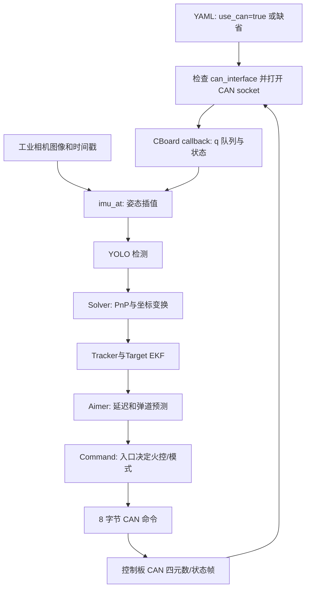
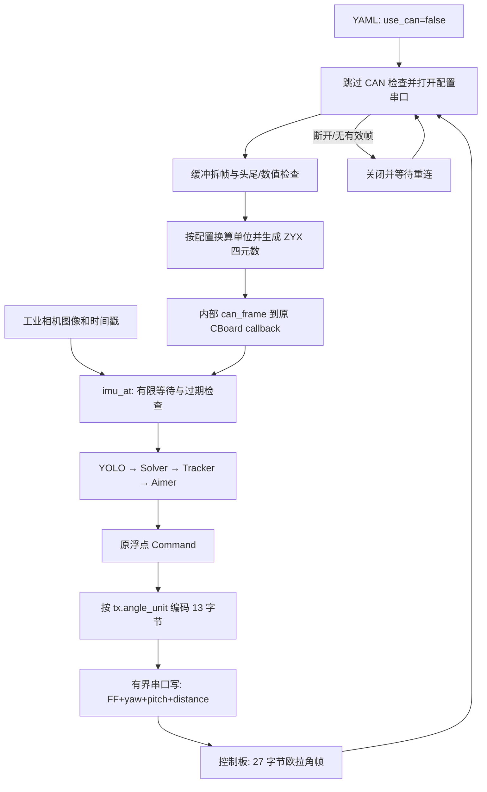
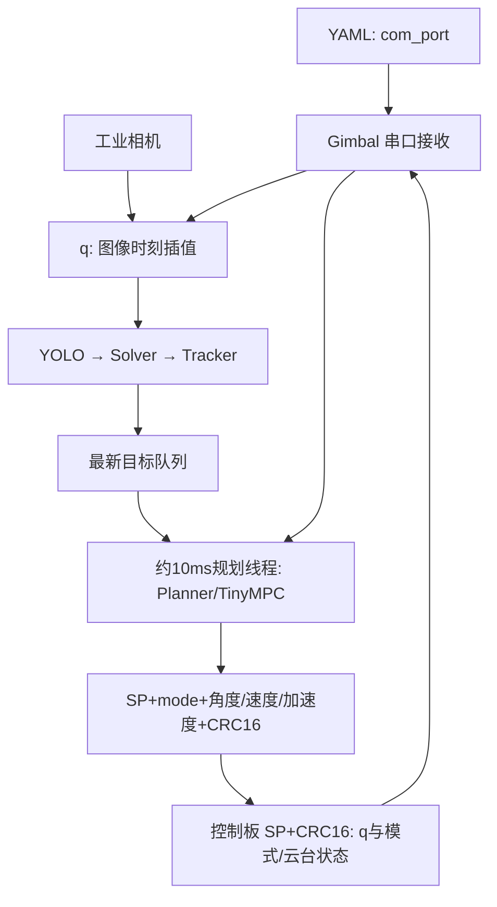

# 新旧版本差异、运行流程与使用说明

本文依据当前源码、[PROJECT_INTRODUCTION.md](PROJECT_INTRODUCTION.md)、[readme.md](readme.md) 整理。旧版本指基准提交 `bd9f5e7` 的 CBoard/CAN 路径，新版本指本地增加的 **CBoard + 自定义 UART** 路径，协议以 [new_uart1.png](new_uart1.png)、[new_uart2.png](new_uart2.png) 为准。检查日期：2026-10-10。

原项目文档还把 **Gimbal + SP/CRC + MPC** 称为“新链路”。它是原仓库已有的另一条路径，与本次串口改造不同，不能因同为 `/dev/ttyACM0` 就混用。详细字节布局与实测结果见 [SERIAL_IMU_GUIDE.md](SERIAL_IMU_GUIDE.md)。

若要阅读原始 `standard_mpc` 的完整自瞄调用链、Planner 预测与 TinyMPC 过程，见 [PLANNER_DEVELOPMENT_GUIDE.md](PLANNER_DEVELOPMENT_GUIDE.md)。

> 现场修复：当前固件仍为 `0D 00`，`sentry.yaml` 已显式配置此帧尾，解决接收数据正常但无法识别有效帧的问题。标准示例和解析器默认仍为新图 `00 0D`。固件升级后需将 sentry 的 tail 改回标准值。`cboard_test` 也已捕获异常并返回错误码，避免未捕获异常导致 terminate。

## 1. 图片核对结论

| 检查项 | 新图片标准 | 当前实现/配置 | 结果 |
| --- | --- | --- | --- |
| MCU → PC 长度 | 27 字节 | `uart27` 固定 27 字节 | 代码与测试通过 |
| 接收头尾 | `01 00` / `00 0D` | 标准示例/默认一致；sentry 显式配置现场旧尾 `0D 00` | 两种配置各自严格验证通过 |
| 接收字段顺序 | pitch@2、roll@6、yaw@10 | RPY 偏移 `[6,2,10]` | 代码与测试通过 |
| 固件轴映射 | pitch=-INS.roll，roll=-INS.pitch | 默认符号 `[1,1,1]`，不重复取负 | 独立样例通过；实机待验证 |
| 欧拉角 → 四元数 | 兼容原算法接口 | ZYX 组合、归一化、内部 CAN 帧回调 | 测试通过 |
| PC → MCU | FF + yaw@1 + pitch@5 + distance@9 | 小端 float32，13 字节 | 字节级测试通过 |
| 控制/开火/发送帧尾 | 图片没有这些字段 | 不插入字段，非空 `tx.tail` 报错 | 测试通过 |
| 角度单位 | 图片未说明 | RX/TX 各自配置 degrees/radians | 单位测试通过；实机需约定 |
| ttyACM0 实测 | 应为新标准尾 `00 0D` | 2001 帧全部为旧尾 `0D 00` | **硬件整体未通过** |

已经修正先前实现中的接收轴偏移、尾字节顺序和旧下行布局。当前代码以两张新图为标准；真实控制板还需更新固件并联调，软件测试通过不等于实车闭环通过。

## 2. 项目结构与算法

项目是 C++17 机器人视觉系统，负责相机取图、装甲检测、空间解算、目标跟踪、预测瞄准和命令下发。

| 目录/文件 | 职责 | 本次相关性 |
| --- | --- | --- |
| `src/` | 机器人及单/多线程入口 | 决定使用 CBoard 还是 Gimbal |
| `io/camera.*`、相机后端 | 工业相机驱动和时间戳 | 需要现场相机参数 |
| `io/cboard.*` | 姿态队列、插值、状态、命令接口 | 复用接口，补充等待/新鲜度检查 |
| `io/socketcan.hpp` | 打开/关闭、收发、线程/重连 | 按 `use_can` 分支 |
| `io/serial_imu_protocol.hpp` | 27 字节拆帧、欧拉角转换 | 新接收适配 |
| `io/serial_command_protocol.hpp` | 13 字节 float 编码 | 新发送适配 |
| `io/gimbal/` | 原 SP/CRC 串口收发 | 本次改造独立于它 |
| `tasks/auto_aim/` | 检测、Solver、Tracker、Target、Aimer、Planner、Shooter | 核心算法复用 |
| `tasks/auto_buff/`、`tasks/omniperception/` | 能量机关、哨兵全向感知 | 还需相应模式反馈和硬件 |
| `tools/` | 队列、数学、弹道、日志、录像、曲线 | 队列增加有限时间等待 |
| `configs/`、`calibration/`、`tests/` | 参数、标定、独立验证 | 新增 UART 配置和回归测试 |

一帧视觉数据主要经过：

1. `Camera` 给出 BGR 图像和 PC 单调时钟时间，姿态接口取相邻四元数并做 slerp。`standard` 请求 `t - 1ms`，这是当前入口的固定偏移，不是 MCU/PC 硬件同步。
2. 配置选择 YOLOv5/v8/11，输出装甲类别与角点；OpenVINO 执行推理，可配置传统方法修正角点等行为。
3. `Solver` 用内参、畸变和装甲尺寸做 PnP/IPPE 解算，结合手眼外参和 IMU 变换到世界坐标，并做 yaw 重投影优化。
4. `Tracker/Target` 将装甲关联到整车，用 11 维 EKF 估计中心位置/速度、车体角度/角速度、半径及高度差，处理装甲切换和旋转。
5. `Aimer` 补偿处理/发射延迟，结合弹道飞行时间预测瞄准点；当前迭代最多 10 次，飞行时间变化小于 0.001 秒时收敛。另一条 `Planner` 路径用 TinyMPC 输出角度、速度、加速度轨迹。
6. 入口决定是否调用 `Shooter`、是否按模式执行任务和如何发送。通信格式无法自动补齐入口缺少的火控判断或模式信息。

`Solver::set_R_gimbal2world(q)` 使用 `R_gimbal2imubody` 进行旋转基变换：`Rᵀ × q.toRotationMatrix() × R`。固件交换/取负轴后，姿态基和外参必须一致。欧拉角转换只是数据适配，不能证明现有标定适用于新安装。

## 3. 新旧版本差异

| 项目 | 原 CBoard/CAN | 本次 CBoard/UART | 原 Gimbal/SP/MPC |
| --- | --- | --- | --- |
| 设备 | Linux CAN 接口，如 can0 | STM32 USB CDC 串口 | `com_port` 指定的串口 |
| 选择 | `use_can` 缺省或 true | `use_can: false` | 程序直接构造 Gimbal |
| 姿态输入 | CAN ID 区分，x/y/z/w int16÷10000 | 27 字节欧拉角 float，转内部 q 帧 | SP、w/x/y/z float、CRC16 |
| 接收其他状态 | 弹速、模式、左右枪、ft_angle | 标准中没有，使用初始化值 | 模式、云台角度/速度、弹速、弹丸计数 |
| 输出 | 8 字节；标志 + yaw/pitch/distance int16×10000 | 13 字节；FF + yaw/pitch/distance float32 | 29 字节；SP + mode + 六个 float + CRC16 |
| 角度 | CAN 弧度 | 算法弧度，RX/TX 单位独立配置 | 原 Gimbal 协议约定 |
| 控制/开火 | 两个独立字节 | 不可表达 | mode=0/1/2 表达不控制/控制/开火 |
| 校验 | CAN 总线帧校验，应用检查 q 等 | 头尾/长度/数值检查，无 CRC | CRC16 |
| 决策路径 | Aimer，部分入口调用 Shooter | 保留原 CBoard 算法路径 | Planner + TinyMPC |
| 改动范围 | 基准路径 | 收发适配、配置、等待/重连保护 | 本次未改造其协议 |

旧 CAN 命令 int16 量程缩放后约为 `[-3.2768, 3.2767]`，角度和距离共用 10000 缩放；新 UART 直接发送 float32，避免这一步截断和量程限制。当前 CAN 编码也增加了有限值和量程检查，超范围会记录发送错误。

UART 模式不会访问 CAN 设备。CBoard 仍保留三个 ID 配置和检查，UART 接收仅生成四元数 ID 的内部回调；另两个 ID 不对应 UART 物理字段。发送来自原 `Command`，不先编码 CAN 再反解浮点。

工作线程负责打开、读取、重连，发送与打开/关闭共用锁。新增有界写等待、损坏帧恢复、独占串口、退出清理、姿态超时/过期拒绝和队列丢旧保新。帧中缺少 CRC、时间戳、状态和应答的限制仍然存在。

## 4. 三条运行流程

### 4.1 原 CBoard/CAN



### 4.2 本次 CBoard/UART



改动在收帧和发命令边界，后续视觉模块仍拿到四元数。UART 无状态帧，因此这里没有模式切换、实时弹速反馈或完整火控闭环。

### 4.3 原 Gimbal/SP/CRC + MPC



其 packed 接收结构为 43 字节，发送为 29 字节，见 [io/gimbal/gimbal.hpp](io/gimbal/gimbal.hpp)。`standard_mpc` 不通过 `SocketCAN`，`use_can` 不会把它切换到新图协议。独立 `DM_IMU` 又使用 `55 AA` 的另一种协议，`dm_test` 也不适用于本次设备。

## 5. 选择正确程序

| 目的 | 程序/配置 | 当前 UART 适用性 |
| --- | --- | --- |
| 自动测试新协议 | `serial_imu_test` / CTest | PTY 模拟，无需设备 |
| 只读检查新 UART 姿态 | `cboard_test configs/serial_imu.yaml` | 正确入口，不发送控制命令 |
| 单工业相机 + 新 UART 自瞄 | `standard configs/sentry.yaml` | 通信适用；需正确相机/标定/模型，且缺少控制/火控字段 |
| 标定采集 | `capture` 加完整 CBoard 相机配置 | 适用；采集板固定为 10×7 圆点 |
| 多线程/无人机模式入口 | `mt_standard`、`uav` 等 | 部分按 mode 决定运行；UART mode 留在 idle，不能直接视作可用 |
| 哨兵完整流程 | `sentry*` | 还需 ROS2/sp_msgs、多相机和导航，不是单相机示例 |
| 原 SP 联调/MPC | `gimbal_test`、`standard_mpc` | 不适用新图协议 |
| 装甲离线回放 | `auto_aim_test` | 不读取真实串口 |

`configs/sentry.yaml` 是配置文件名，不代表必须运行 `sentry`。通信类由入口源码决定。`configs/serial_imu.yaml` 只含通信参数，没有视觉算法完整配置。

当前 `standard` 构造了 `Shooter` 但未调用，mode 仅用于日志，仍执行检测和发送。它适合验证检测到瞄准角的链路，不具备完整模式与火控管理。无目标时即使算法返回 `control=false`，新 UART 也无法传达“不接管”，下位机需明确处理目标失效行为。

UART 下 `bullet_speed=0`、`mode=idle`、`shoot_mode=left_shoot`、`ft_angle=0`。当前 Aimer 弹速小于 14 m/s 时回退到 23 m/s，这是算法现有行为，非 UART 测得。真实弹速不一致会影响弹道；不能从帧中保留零字节推断弹速或模式。Aimer 未填写 `horizon_distance`，普通 standard 发送距离为 0。

## 6. 编译与分步使用

所有命令在项目根目录执行，模型、配置、数据存在相对路径依赖：

```bash
cd /home/kendas/桌面/zimiao/sp_vision_25
cmake -S . -B build
cmake --build build --target serial_imu_test cboard_test standard capture -j2
ctest --test-dir build -R serial_imu_protocol --output-on-failure
```

需要 OpenCV、Eigen、fmt、spdlog、yaml-cpp、nlohmann-json、libusb、Ceres、OpenVINO 和相机 SDK。当前 CMake 固定 OpenVINO 路径为 `/opt/intel/openvino_2024.6.0/runtime/cmake/`，路径不同需调整相关 CMake 配置。`io` 链接海康和迈德威视 SDK，即使离线测试也不能默认跳过这些构建依赖。ROS2 是哨兵目标的额外依赖，当前环境未检测到完整 ROS2，因此相关目标未构建。安装步骤见 [DEVELOPMENT_GUIDE.md](DEVELOPMENT_GUIDE.md)。

### 6.1 通信先行

1. 核对实际帧尾。当前固件为 `0D 00`，使用已经覆盖该配置的 sentry；固件更新为 `00 0D` 时同步改回配置。另核对发送缓冲区/长度及下行按 13 字节累积解析。
2. [configs/serial_imu.yaml](configs/serial_imu.yaml) 填真实串口路径，分别确认 RX `angle_unit`、TX `tx.angle_unit`；图片没有提供单位。
3. 运行只读程序：

```bash
./build/cboard_test configs/serial_imu.yaml
```

上述命令用于新图标准固件。当前现场固件运行 `./build/cboard_test configs/sentry.yaml`，否则标准示例仍将拒绝旧尾并超时。

4. 逐轴移动云台，核对方向、零位与累积角。静止样本不能证明轴向正确。确认后核对相机外参和 `R_gimbal2imubody`。

默认配置采用 USB by-id 路径，避免插拔后 ttyACM 编号改变。查找路径与占用可用：

```bash
ls -l /dev/serial/by-id/
fuser /dev/ttyACM0
```

### 6.2 相机、标定与视觉

先单独测试相机和离线算法：

```bash
cmake --build build --target camera_test auto_aim_test planner_test_offline -j2
./build/camera_test --config-path=configs/camera.yaml --display
./build/auto_aim_test --config-path=configs/demo.yaml assets/demo/demo
./build/planner_test_offline configs/standard3.yaml
```

`io::Camera` 工厂支持 hikrobot/mindvision，普通 UVC 是独立 `USBCamera` 测试路径，不能仅修改 `camera_name` 就替换主入口。曝光、增益、设备标识和帧率见 [CAMERA_GUIDE.md](CAMERA_GUIDE.md)。

现场需要实际相机/镜头的内参、畸变和安装位置对应的 `R_camera2gimbal/t_camera2gimbal`，并核对新姿态轴约定。标定见 [CALIBRATION_GUIDE.md](CALIBRATION_GUIDE.md)：`capture` 保存成对 JPG 和 w/x/y/z 四元数 TXT，`calibrate_camera` 输出内参，`calibrate_handeye` 求外参。标定板与 `pattern_cols/pattern_rows/center_distance_mm` 必须一致；`capture` 固定 10×7 规格要一并检查。

确认通信、相机与标定后，单相机链路可使用：

```bash
./build/standard configs/sentry.yaml
```

该配置已接入新 UART，相机/标定/模型/阈值仍需现场设置。程序会发送 yaw/pitch/distance；TX 实际行为、距离用途/单位以及缺少 fire/control 时的控制策略尚需真实控制板联调。

### 6.3 恢复旧 CAN / 使用原 SP

旧 CBoard 入口使用完整配置，设 `use_can: true`、`can_interface` 和原 ID，再按电控约定启用 CAN。串口配置可以保留，但不会用于 CAN 收发。

原 `standard_mpc configs/standard3.yaml` 需要 SP 固件、`com_port` 及完整 MPC/打符参数。它发送模式、速度和加速度前馈，不能只交换配置文件就连接本次 27/13 字节设备。

## 7. 记录、排障与验收

离线 `auto_aim_test` 使用同名 AVI/TXT，TXT 每行 `time w x y z`。同一时钟下的视频和姿态用于复现。`tools::Recorder` 可生成这种数据，但 `standard` 的录制调用当前被注释，不能假设运行后自动录像。日志默认写 `logs/`，Plotter 向 `127.0.0.1:9870` 输出 UDP。

| 现象 | 优先检查 |
| --- | --- |
| UART 模式仍有 can0 打开错误 | 实际入口是否为 CBoard、实际 YAML 是否 `use_can: false`；Gimbal 不读取该开关 |
| Waiting for q 后超时 | 路径/占用/权限、27 字节长度、实际尾与 YAML 是否一致、角度是否有限；初次需连续两帧 |
| IMU receive timeout / stale | 断流、非法帧、等待设置、线程延迟和相机时间戳；不能用过期姿态继续解算 |
| UART write timeout | MCU 接收、设备断开/背压；将触发重连，命令没有 MCU 应答保证 |
| 多线程入口保持 idle | 标准没有 mode，原入口的模式条件不满足 |
| 跟踪反向或世界坐标漂移 | 单位、轴偏移/符号、ZYX 约定、姿态基和手眼标定 |
| 距离始终为 0 | Aimer 未填写 horizon_distance，不是 float 精度问题 |
| control/shoot 没作用 | 新下行没有对应字段，需另行协商固件协议 |

软件验收已完成：`serial_imu_test`、`cboard_test`、`standard`、`capture` 构建通过，CTest `serial_imu_protocol` 1/1 通过。测试使用独立字节样例和 PTY，未向真实设备发送命令。

硬件验收尚未完成：ttyACM0 捕获的 2001 帧仍为旧尾 `0D 00`。更新固件后需核对轴向/单位、连续读取与插拔恢复、相机姿态一致性及 MCU 下行解析/执行。USB ID 只能确认 STM32 虚拟串口，不能确认 IMU 型号。

本次故障再次采样的 2000 帧仍为相同旧尾。通过 sentry 的明确配置覆盖可接收当前固件；新图标准符合性和下行实车闭环仍需后续验收。

修复后的只读实机检查约 2 秒输出 1823 条姿态，无超时或错误，正常停止返回 0；不存在设备的失败路径返回 1 且不再 terminate。协议回归测试再次 1/1 通过。

原 `autostart.sh` 使用固定 `~/Desktop/sp_vision_25/` 且依赖本地 watchdog 脚本，不能视作当前中文桌面目录下已可部署。启动工作目录、入口和配置需设置为本机已验证的实际路径。

## 8. 关键源码索引

- 传输分支与重连：[io/socketcan.hpp](io/socketcan.hpp)
- RX 拆帧和转换：[io/serial_imu_protocol.hpp](io/serial_imu_protocol.hpp)
- TX 浮点编码：[io/serial_command_protocol.hpp](io/serial_command_protocol.hpp)
- 姿态插值与发送：[io/cboard.cpp](io/cboard.cpp)
- 单相机入口：[src/standard.cpp](src/standard.cpp)
- 原 MPC 入口：[src/standard_mpc.cpp](src/standard_mpc.cpp)
- 图片样例与 PTY 回归：[tests/serial_imu_test.cpp](tests/serial_imu_test.cpp)
- 通信配置：[configs/serial_imu.yaml](configs/serial_imu.yaml)
